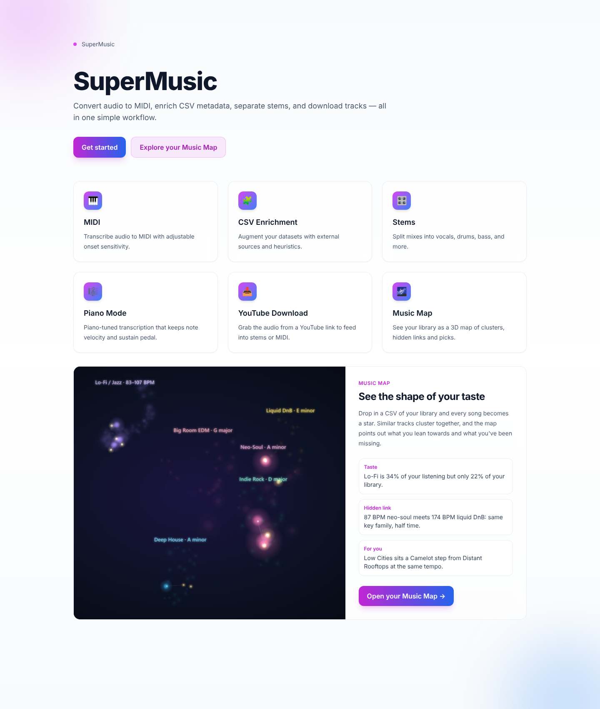
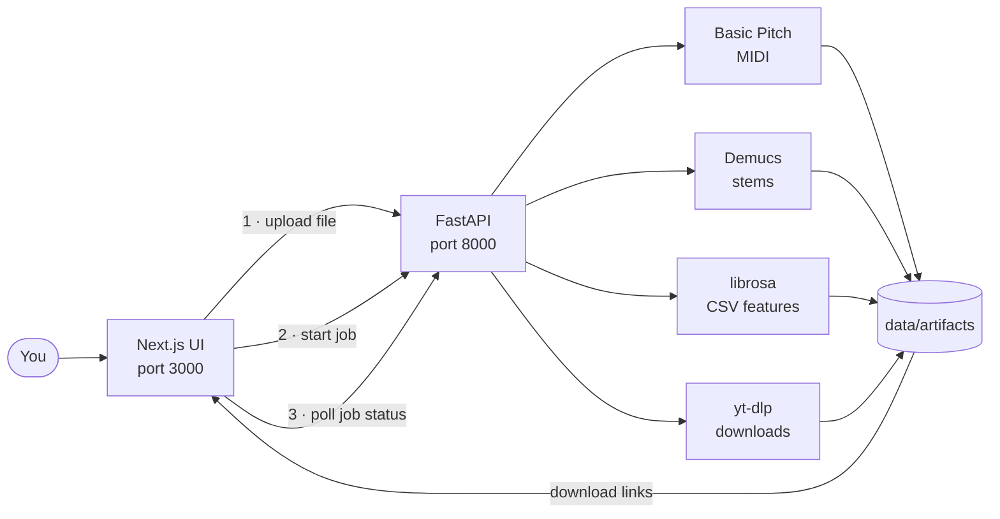

<div align="center">

# 🎧 SuperMusic

**Turn any song into MIDI, stems and rich metadata, all from one web app.**

[](https://github.com/agangdut/supermusic/actions/workflows/ci.yml)


[Quickstart](#-quickstart) · [Features](#-features) · [Docs](docs/index.md) · [API](docs/api.md) · [Roadmap](docs/roadmap.md)



</div>

---

## ✨ Features

| | What it does | Powered by |
|---|---|---|
| 🎹 **Audio → MIDI** | Transcribes a song into a playable `.mid` file. **Auto** detects the instruments; **Stems** gives one track per instrument; **Piano** is tuned for piano ([accuracy](docs/transcription-accuracy.md)). Tick **Playable by two hands** to get a left/right hand part a pianist can actually play ([how](docs/playable-piano.md)) | [Basic Pitch](https://github.com/spotify/basic-pitch), [ByteDance piano model](https://github.com/bytedance/piano_transcription) (MAESTRO) |
| 🥁 **Stem separation** | Splits a mix into vocals, drums, bass and other | [Demucs](https://github.com/facebookresearch/demucs) |
| 🧾 **CSV enrichment** | Adds BPM, key and duration to a track list, plus YouTube and MusicBrainz info | librosa |
| ⬇️ **Track download** | Grabs the audio from a YouTube (or similar) link | [yt-dlp](https://github.com/yt-dlp/yt-dlp) |
| 🌌 **Music Map** | Turns your library into a 3D constellation: taste clusters, hidden connections between genres, and picks you've been missing | UMAP, scikit-learn, three.js |
| 📦 **Batch and export** | Runs many files at once and zips up the results | FastAPI |

Every task runs as a **job**. You start it, the page checks on it every two seconds, and the finished files appear as downloads.

### 🌌 Music Map

Drop in a CSV of your library and see it as a galaxy. Tracks that sound alike cluster together, the clusters you play most glow brightest, and pink threads link songs from different scenes that would mix well (same key, half-time tempo, similar mood). Add a `play_count`, `rating` or `liked` column and it learns your taste and suggests tracks you've been overlooking.

<div align="center">

</div>

More in the [Music Map guide](docs/music-map.md).

### 🎛️ Workspace

<div align="center">

</div>

---

## 🚀 Quickstart

All you need is [Docker Desktop](https://www.docker.com/products/docker-desktop/).

```bash
git clone https://github.com/agangdut/supermusic.git
cd supermusic
docker compose up --build
```

| Open | To |
|---|---|
| http://localhost:3000 | see the app |
| http://localhost:3000/upload | upload a song or CSV and run a job |
| http://localhost:3000/map | explore the Music Map (opens with a sample library) |
| http://localhost:8000/docs | try the API in your browser |

> ⏱️ The first build takes several minutes because it installs the machine-learning libraries (the backend image is about 3.4 GB). Later builds are much faster.

Your uploads and results are saved in `./data`, so they survive a restart.

<details>
<summary><b>Run it without Docker</b></summary>

You'll also need **ffmpeg** on your PATH and **Node 18+**.

```bash
# Backend, from the repo root
python -m venv .venv
.venv\Scripts\activate          # macOS/Linux: source .venv/bin/activate
pip install torch torchaudio --index-url https://download.pytorch.org/whl/cpu --extra-index-url https://pypi.org/simple
pip install -r requirements.txt
uvicorn app.main:app --app-dir backend --reload
```

```bash
# Frontend, in a second terminal
cd frontend
npm install
npm run dev
```

</details>

---

## 🧭 How it fits together



The full picture is in [docs/architecture.md](docs/architecture.md).

---

## 🗂️ Project layout

```
backend/      FastAPI app: routes, job pipelines, auth, tests
frontend/     Next.js UI (pages router + Tailwind)
data/         Uploads and results at runtime (git-ignored)
docs/         Guides, API reference, roadmap, screenshots
scripts/      CLI helpers, deploy scripts, research notebooks
supermusic/   Small Jinja web app from an earlier iteration
legacy/       The first prototype (mixtape segmenter, desktop UI, …)
```

---

## ⚙️ Configuration

Copy `.env.example` to `.env` and change what you need. The ones that matter most:

| Variable | Default | What it's for |
|---|---|---|
| `JWT_SECRET_KEY` | `change-me-in-production` | Signs login tokens. **Change it before you deploy.** |
| `CORS_ORIGINS` | `http://localhost:3000,…` | Which websites may call the API |
| `YOUTUBE_API_KEY` | _(none)_ | Optional. Adds YouTube details during CSV enrichment |
| `NEXT_PUBLIC_API_BASE` | `http://localhost:8000` | Where the UI finds the API (fixed when the UI is built) |

Every setting is listed in [docs/configuration.md](docs/configuration.md).

---

## 🧪 Tests

```bash
docker compose exec backend python -m pytest -q backend/tests
```

On every push to `master`, CI runs the backend tests and builds the frontend.

---

## 🛣️ Roadmap

The core pipelines (MIDI, stems, CSV, download) and the Music Map work end to end. To become a finished product, SuperMusic still needs jobs and accounts that survive a restart, a proper job queue, sign-in in the UI, and screens for downloads, batch and export. The full list is in **[docs/roadmap.md](docs/roadmap.md)**.

---

## 📜 License

[MIT](LICENSE) © 2025 Agang Dut
