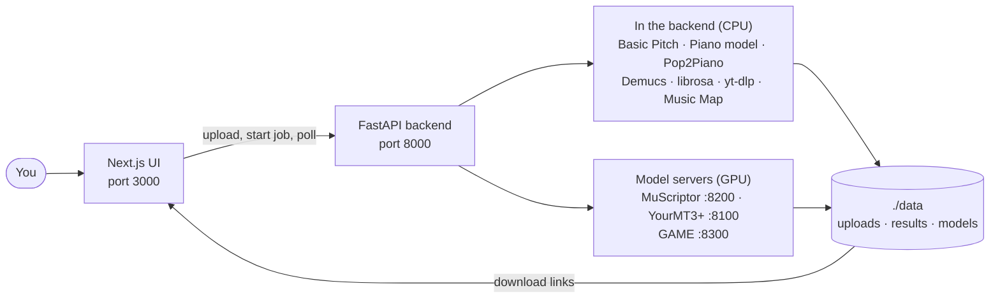

<div align="center">

# 🎧 SuperMusic

**Turn any song into MIDI, stems, a playable piano part and a map of your taste, all from one web app.**

[](https://github.com/agangdut/supermusic/actions/workflows/ci.yml)


[Where things stand](#-where-things-stand) · [Quickstart](#-quickstart) · [Features](#-features) · [How it works](docs/how-it-works.md) · [All docs](docs/index.md) · [Roadmap](docs/roadmap.md)


</div>

---

## 📍 Where things stand

_October 2026._ New here? Read this, then **[How it works](docs/how-it-works.md)**, the one guide that explains the whole project (written for a CS student new to ML).

- **Audio → MIDI works.** **MuScriptor** is the default full-band engine: on real pop songs it scores 0.47 overall F1, against 0.35 for YourMT3+ and 0.14 for Basic Pitch. Solo piano is near perfect (0.97) with the Piano model. ([benchmarks](docs/transcription-accuracy.md))
- **Voices** get their own clean "Lead vocal" track. **GAME**, a singing-only model, is wired in and being benchmarked against MuScriptor's own voice track.
- **Playable piano** works: "Playable by two hands", Piano cover (Pop2Piano), and a piano MP3 preview of every result.
- **Music Map** works from a CSV or Spotify / Apple Music exports. Genres roll Spotify's detailed tags into ~20 broad ones, with an online lookup for songs that have none.
- **Research:** learned music models group songs by genre far better than the map's own features: CLAP 39%, MERT 29%, the map 16% same-genre neighbours. Adding a CLAP vector per song to the map is the likely next step.
- **Not done yet:** jobs and accounts are lost on restart, no job queue, no login screen, no YouTube screen, no deploy setup. See the [roadmap](docs/roadmap.md).

---

## ✨ Features

| | What it does | Powered by |
|---|---|---|
| 🎹 **Audio → MIDI** | Transcribes a song into a `.mid` file. **Auto** detects the instruments; **Full band** transcribes every instrument in a mix (MuScriptor, the most accurate on pop); **Piano** is tuned for solo piano; the singer becomes a clean **Lead vocal** track. Tick **Playable by two hands** for a left/right hand part a pianist can play ([how](docs/playable-piano.md)), or pick **Piano cover** to have the song arranged for piano. Every result comes with a piano MP3 preview ([accuracy](docs/transcription-accuracy.md)) | [MuScriptor](https://github.com/muscriptor/muscriptor), [YourMT3+](https://github.com/mimbres/YourMT3), [Basic Pitch](https://github.com/spotify/basic-pitch), [ByteDance piano model](https://github.com/bytedance/piano_transcription), [Pop2Piano](https://github.com/sweetcocoa/pop2piano), [GAME](https://github.com/openvpi/GAME) |
| 🥁 **Stem separation** | Splits a mix into vocals, drums, bass and other | [Demucs](https://github.com/facebookresearch/demucs) |
| 🧾 **CSV enrichment** | Adds BPM, key and duration to a track list, plus YouTube and MusicBrainz info | librosa |
| ⬇️ **Track download** | Grabs the audio from a YouTube (or similar) link (API only for now) | [yt-dlp](https://github.com/yt-dlp/yt-dlp) |
| 🌌 **Music Map** | Turns your library (a CSV, or Spotify / Apple Music exports) into a 3D constellation: taste clusters, hidden connections between genres, picks you've been missing, and search by how songs sound | UMAP, scikit-learn, three.js, CLAP |
| 📦 **Batch and export** | Runs many files at once and zips up the results | FastAPI |

Every task runs as a **job**. You start it, the page shows its progress and time left, and the finished files appear as downloads.

### 🌌 Music Map

Drop in a CSV of your library, or your Spotify / Apple Music export, and see it as a galaxy. Tracks that sound alike cluster together, the clusters you play most glow brightest, and pink threads link songs from different scenes that would mix well (same key, half-time tempo, similar mood). Add a `play_count`, `rating` or `liked` column and it learns your taste and suggests tracks you've been overlooking.

<div align="center">

</div>

More in the [Music Map guide](docs/music-map.md).

### 🎛️ Workspace

<div align="center">

</div>

---

## 🚀 Quickstart

All you need is [Docker Desktop](https://www.docker.com/products/docker-desktop/).

```bash
git clone https://github.com/agangdut/supermusic.git
cd supermusic
docker compose up --build
```

Have an NVIDIA GPU? Run `docker compose -f docker-compose.yml -f docker-compose.gpu.yml up --build` instead, so the model servers (MuScriptor, YourMT3+ and GAME) run on it.

**For Full band (MuScriptor)**, copy `.env.example` to `.env`, accept the licence on [MuScriptor/muscriptor-medium](https://huggingface.co/MuScriptor/muscriptor-medium), and put a free Hugging Face read token in `HF_TOKEN`. Without it, Auto falls back to YourMT3+.

| Open | To |
|---|---|
| http://localhost:3000 | see the app |
| http://localhost:3000/upload | upload a song or CSV and run a job |
| http://localhost:3000/map | explore the Music Map (opens with a sample library) |
| http://localhost:8000/docs | try the API in your browser |

> ⏱️ The first build takes several minutes because it installs the machine-learning libraries (the backend image is about 3.4 GB). Later builds are much faster.

Your uploads and results are saved in `./data`, so they survive a restart.

<details>
<summary><b>Run it without Docker</b></summary>

You'll also need **ffmpeg** on your PATH and **Node 18+**.

```bash
# Backend, from the repo root
python -m venv .venv
.venv\Scripts\activate          # macOS/Linux: source .venv/bin/activate
pip install torch torchaudio --index-url https://download.pytorch.org/whl/cpu --extra-index-url https://pypi.org/simple
pip install -r requirements.txt
uvicorn app.main:app --app-dir backend --reload
```

```bash
# Frontend, in a second terminal
cd frontend
npm install
npm run dev
```

</details>

---

## 🧭 How it fits together



The full picture, including why each big model has its own container and how a job flows, is in [How it works](docs/how-it-works.md#2-the-system-one-backend-three-model-servers-and-a-job-pattern).

---

## 🗂️ Project layout

```
backend/      FastAPI app: routes, job pipelines, auth, tests
frontend/     Next.js UI (pages router + Tailwind)
services/     Model servers: MuScriptor, YourMT3+, GAME (one container each)
data/         Uploads, results and model weights at runtime (git-ignored, as are all *.mp3 / *.mid files)
docs/         Guides, API reference, roadmap, screenshots
scripts/      Benchmarks (eval_*), comparisons, dataset builders, deploy scripts
supermusic/   Small Jinja web app from an earlier iteration
legacy/       The first prototype (mixtape segmenter, desktop UI, …)
```

---

## ⚙️ Configuration

Copy `.env.example` to `.env` and change what you need. The ones that matter most:

| Variable | Default | What it's for |
|---|---|---|
| `JWT_SECRET_KEY` | `change-me-in-production` | Signs login tokens. **Change it before you deploy.** |
| `CORS_ORIGINS` | `http://localhost:3000,…` | Which websites may call the API |
| `HF_TOKEN` | _(none)_ | Hugging Face token for MuScriptor's weights (needed for Full band) |
| `LASTFM_API_KEY` | _(none)_ | Optional. More accurate Music Map genres |
| `YOUTUBE_API_KEY` | _(none)_ | Optional. Adds YouTube details during CSV enrichment |
| `NEXT_PUBLIC_API_BASE` | `http://localhost:8000` | Where the UI finds the API (fixed when the UI is built) |

Every setting is listed in [docs/configuration.md](docs/configuration.md).

---

## 🧪 Tests

```bash
docker compose exec backend python -m pytest -q backend/tests
```

On every push to `master`, CI runs the backend tests and builds the frontend.

---

## 📚 Docs

| Start here | Then, when you need it |
|---|---|
| 🎓 [How it works](docs/how-it-works.md): the whole project explained | [Usage](docs/usage.md) · [Transcription accuracy](docs/transcription-accuracy.md) · [Playable piano](docs/playable-piano.md) · [Music Map](docs/music-map.md) · [Training data](docs/training-data.md) · [API](docs/api.md) · [Configuration](docs/configuration.md) · [Roadmap](docs/roadmap.md) |

---

## 📜 License

[MIT](LICENSE) © 2025 Agang Dut
