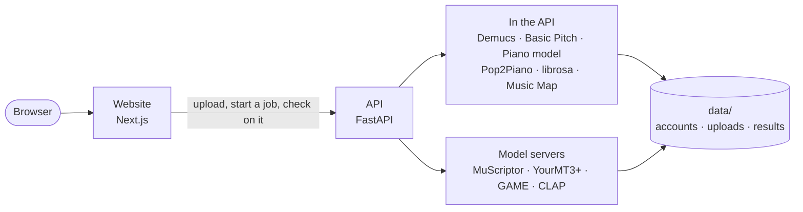

<div align="center">

# SuperMusic

**Turn any song into MIDI, stems and a playable piano part, and see your whole music library as a map of your taste.**

[](https://github.com/agangdut/supermusic/actions/workflows/ci.yml)


[What it does](#what-it-does) · [Run it yourself](#run-it-yourself) · [Host it](docs/deploy.md) · [How it works](docs/how-it-works.md) · [All docs](docs/index.md)


</div>

## What it does

**Music Map.** Import your Spotify or Apple Music history, your Last.fm scrobbles (just type your username), or any CSV of songs, and see your library as a 3D galaxy. Songs that sound alike cluster together, the parts you play most glow brightest, and threads connect songs from different scenes that belong together. Share your map by link, compare it with a friend's, start a radio station from any corner of it, and send that playlist to Spotify or YouTube. ([guide](docs/music-map.md))

**Community.** Sign in to get a profile with your maps, follow people and see what they share, explore the community atlas (every public map in one universe), fix a song's tempo or key for everyone, and play the weekly music quiz.

**Audio to MIDI.** Upload a song and get a `.mid` file with a track per instrument. Auto picks the right model for the song; Full band handles pop and rock mixes; Piano is near perfect on solo piano; the singer comes out as a clean lead vocal line. ([how accurate is it?](docs/transcription-accuracy.md))

**Playable piano.** Tick *Playable by two hands* to get a left and right hand part a real pianist can play, or pick *Piano cover* to have the song arranged for piano. Every result comes with a piano preview you can listen to. ([details](docs/playable-piano.md))

**Stems.** Split a song into vocals, drums, bass and the rest, and turn just the parts you want into MIDI.

**Library clean-up.** Combine any number of CSVs and streaming exports into one deduplicated list, and fill in missing genre, year, tempo, key and energy.

<div align="center">

</div>

## Run it yourself

You need [Docker](https://www.docker.com/products/docker-desktop/).

```bash
git clone https://github.com/agangdut/supermusic.git
cd supermusic
docker compose up --build
```

Then open http://localhost:3000. The first build takes several minutes because it installs the machine-learning libraries.

- **NVIDIA GPU?** Use `docker compose -f docker-compose.yml -f docker-compose.gpu.yml up --build` so transcription runs on it, which is many times faster.
- **Full band transcription** uses MuScriptor, whose weights need a free Hugging Face account: copy `.env.example` to `.env`, accept the licence on [MuScriptor/muscriptor-medium](https://huggingface.co/MuScriptor/muscriptor-medium), and put a read token in `HF_TOKEN`. Without it, SuperMusic uses YourMT3+ instead.

Your uploads and results are saved in `./data`. The [usage guide](docs/usage.md) covers every screen and the API, and [configuration](docs/configuration.md) lists every setting.

To put SuperMusic on the internet, follow [Running SuperMusic as a public website](docs/deploy.md) for a server of your own, or [Running SuperMusic on Modal](docs/deploy-modal.md) to have Modal host it with the models on GPUs.

<details>
<summary>Run it without Docker</summary>

You also need ffmpeg on your PATH, Python 3.10 and Node 20.

```bash
# Backend, from the repo root
python -m venv .venv
source .venv/bin/activate            # Windows: .venv\Scripts\activate
pip install torch torchaudio --index-url https://download.pytorch.org/whl/cpu --extra-index-url https://pypi.org/simple
pip install -r requirements.txt
uvicorn app.main:app --app-dir backend --reload
```

```bash
# Frontend, in a second terminal
cd frontend
npm install
npm run dev
```

</details>

## How it fits together



Heavy jobs (stems, transcription) wait in line and run one at a time, so the site stays responsive however many people press the button. Accounts, shared maps and finished jobs are kept in one SQLite file. [How it works](docs/how-it-works.md) explains every part and every model, for readers who can program but are new to machine learning.

```
backend/    API: routes, job pipelines, accounts, tests
frontend/   Website (Next.js and Tailwind)
services/   Model servers, one container each
scripts/    Benchmarks and dataset tools
deploy/     Production setup: Caddy, settings template, backups, Modal app
docs/       Guides, benchmarks, API reference
```

## Contributing

Issues and pull requests are welcome. Before opening a pull request, run the backend tests and build the website:

```bash
docker compose exec backend python -m pytest -q backend/tests
cd frontend && npm run build
```

CI runs both on every pull request. Ideas for what to work on are in the [roadmap](docs/roadmap.md).

## License

SuperMusic's code is [MIT](LICENSE) © 2025 Agang Dut.

The models it downloads have their own licences, and two are for **non-commercial use only**:

| Model | Used for | Licence |
|---|---|---|
| [MuScriptor](https://huggingface.co/MuScriptor/muscriptor-medium) | Full band transcription | CC BY-NC 4.0, non-commercial |
| [GAME](https://github.com/openvpi/GAME) | Lead vocal | CC BY-NC-SA 4.0, non-commercial |
| [YourMT3+](https://huggingface.co/spaces/mimbres/YourMT3) | Full band transcription | Apache 2.0 (code in `services/yourmt3`, see its [NOTICE](services/yourmt3/NOTICE.md)) |
| [Demucs](https://github.com/facebookresearch/demucs), [Basic Pitch](https://github.com/spotify/basic-pitch), [CLAP](https://huggingface.co/laion/clap-htsat-unfused) | Stems, General mode, sound search | MIT / Apache 2.0 |
| [Pop2Piano](https://github.com/sweetcocoa/pop2piano) | Piano covers | See its repository |

No model weights, audio or datasets are stored in this repository; they download on first use.

Only process music you have the right to use. Transcribing or separating a song for your own study is one thing; sharing the stems or MIDI of someone else's song may need the rights holder's permission.
