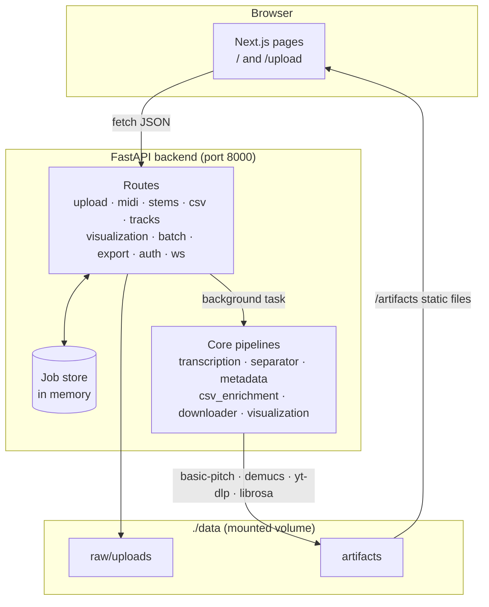
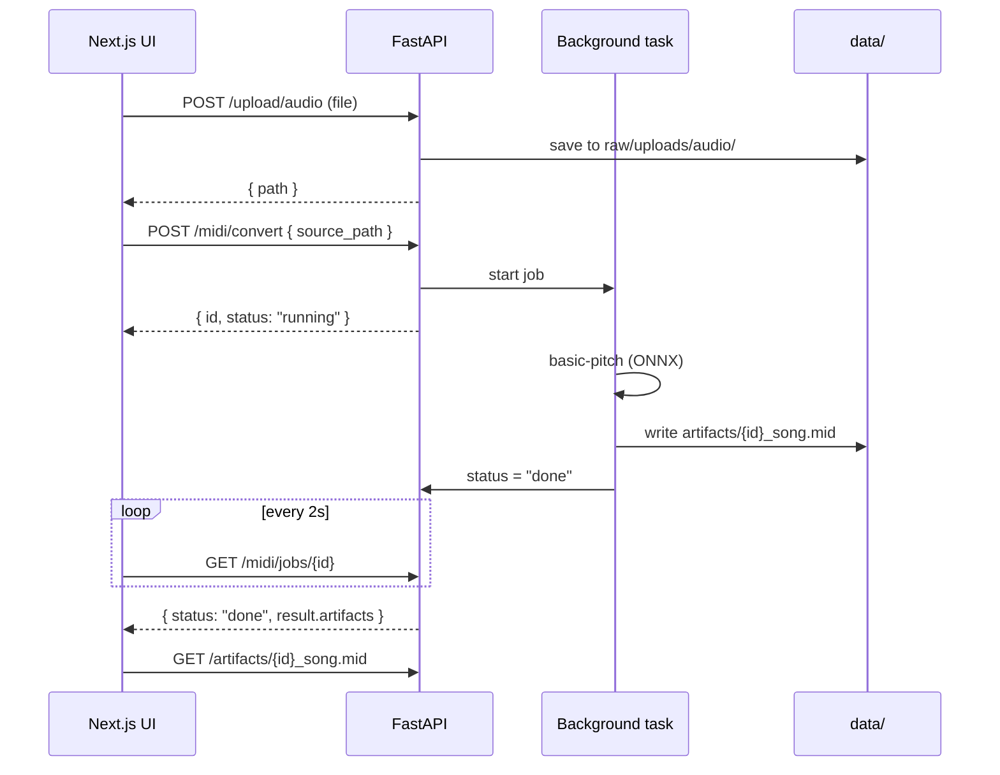

# 🧭 Architecture

SuperMusic is two services, plus Redis (which is running but not used yet).

## A job, step by step

## Where things live

| Folder | What's in it |
|---|---|
| `backend/app/main.py` | App setup: CORS, error handlers, routers, `/artifacts` mount |
| `backend/app/routes/` | One file per area. Each starts a job and exposes `/jobs/{id}` |
| `backend/app/core/` | The real work. Wraps the ML command-line tools and librosa |
| `backend/app/models/job.py` | The `Job` object every route returns |
| `backend/app/utils/storage.py` | In-memory job store and artifact saving |
| `backend/app/database.py` | SQLAlchemy setup, **not wired in yet** |
| `frontend/pages/` | `index.js` (landing + 3D demo) and `upload.js` (the workspace) |
| `frontend/hooks/useUploadJobs.js` | Upload, start job, poll, collect results |
| `frontend/lib/api.js` | Small client for every backend call |

## Tools under the hood

| Task | Tool | Notes |
|---|---|---|
| MIDI | `basic-pitch` CLI | Uses the ONNX model; the TFLite one fails with numpy 2 |
| Stems | `demucs -n htdemucs` | CPU-only torch in Docker to keep the image smaller |
| Download | `yt-dlp` | Needs updating as YouTube changes |
| Features | librosa | BPM, rough key, duration |
| Map | umap-learn + Plotly | |

## Docker images

- **backend**: `python:3.10-slim` + ffmpeg + CPU torch + `requirements.txt`. Runs `uvicorn app.main:app --app-dir backend`.
- **frontend**: `node:18-alpine`, `npm ci` then `next build`, served by `next start`.
- **redis**: `redis:7-alpine`, reserved for a future job queue.
