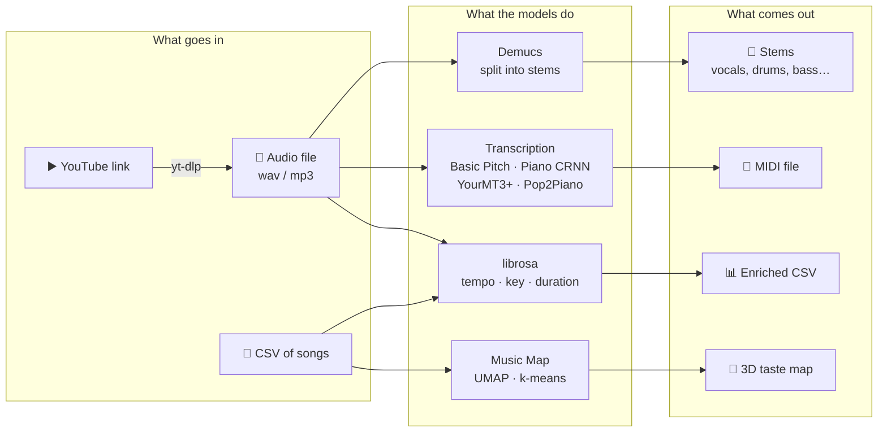
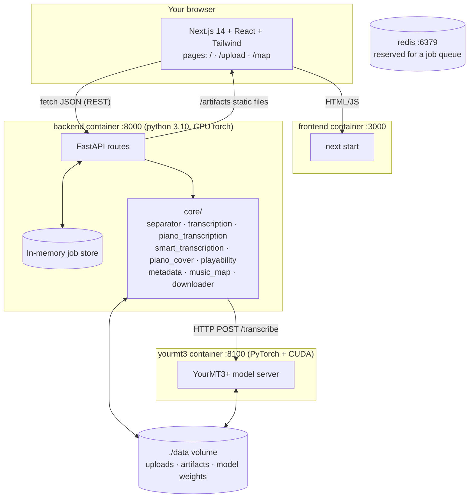
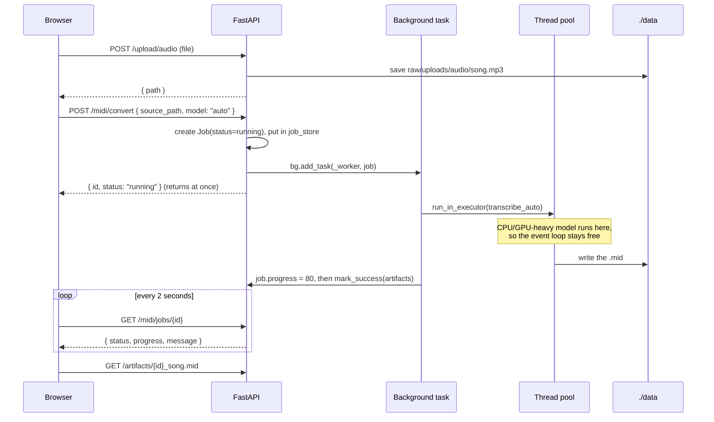
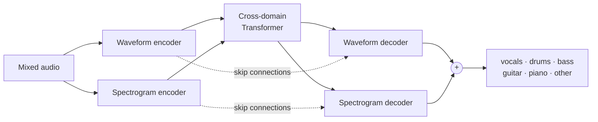
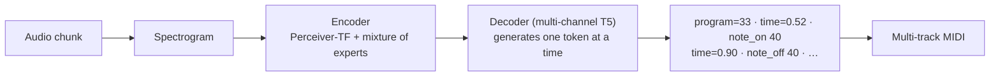
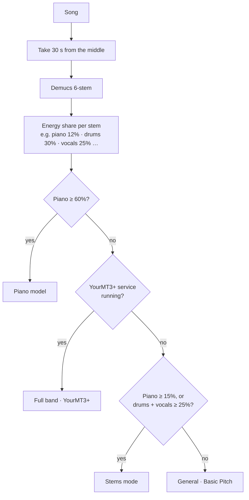
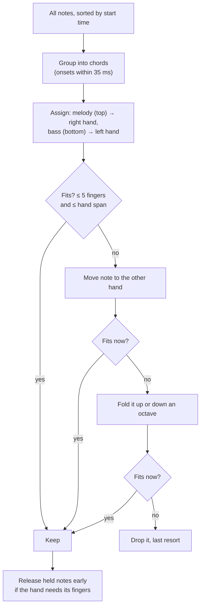
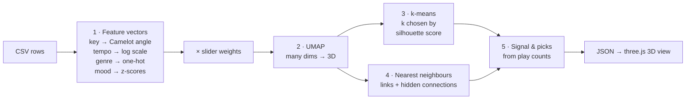

# 🎓 How SuperMusic works: a guide for CS students

This guide walks through the whole project on a technical level, written for someone who knows how to program but is new to machine learning. It explains what each part does, which ML model sits behind it, how we measured whether it works, and what you can learn from it.

You don't need to read it in order. Part 1 is a short ML primer for audio; Part 2 is the system architecture; Parts 3 to 5 cover each ML feature; Part 6 is how we measure them; Part 7 is a study plan.

**Contents**

1. [Machine learning for audio, in ten minutes](#1-machine-learning-for-audio-in-ten-minutes)
2. [The system: three services and a job pattern](#2-the-system-three-services-and-a-job-pattern)
3. [Audio to MIDI: five transcription modes](#3-audio-to-midi-five-transcription-modes)
4. [Making MIDI playable: an algorithm, not a model](#4-making-midi-playable-an-algorithm-not-a-model)
5. [The Music Map: unsupervised learning on your library](#5-the-music-map-unsupervised-learning-on-your-library)
6. [Measuring: how we know any of this works](#6-measuring-how-we-know-any-of-this-works)
7. [What you can learn here, and exercises](#7-what-you-can-learn-here-and-exercises)
8. [Glossary](#8-glossary) and [further reading](#9-further-reading)

---

## The big picture

SuperMusic takes music in (an audio file, a YouTube link, or a spreadsheet of songs) and turns it into something you can study or play: separate instrument tracks, sheet-music-like MIDI, audio features such as tempo and key, or a 3D map of your taste.

Almost all the "intelligence" comes from **pretrained models** written by research groups (Spotify, Meta, ByteDance, and others). This project doesn't train neural networks. What it does is the part most real ML engineering is made of: choosing models, wiring them into a product, tuning their settings, combining them, and **measuring** them honestly.

---

## 1. Machine learning for audio, in ten minutes

### Sound is a list of numbers

A `.wav` file is a list of numbers: the air pressure measured 22,050 or 44,100 times a second (the **sample rate**). A 3-minute song at 44.1 kHz is about 8 million numbers. That's the top panel below.

*Generated by [`scripts/make_guide_figures.py`](../scripts/make_guide_figures.py): a synthetic C major arpeggio followed by a chord.*

Raw samples are hard to learn from, because a single note is a fast wiggle whose shape depends on the instrument. So almost every audio model first converts sound into a **spectrogram** (middle panel):

1. Cut the audio into short overlapping windows (for example 2,048 samples, moving 256 at a time).
2. Run a **Fourier transform** on each window. It tells you how much energy is at each frequency.
3. Stack the results side by side. Now you have an image: time on the x-axis, frequency on the y-axis, loudness as brightness.

A **mel spectrogram** squashes the frequency axis to match human hearing (we hear the difference between 100 and 200 Hz far better than between 5,000 and 5,100 Hz). A **constant-Q transform (CQT)** spaces the bins so each musical semitone gets the same number of bins, which is handy for pitch.

Look at the middle panel: each note is not one line but a stack of lines. The lowest is the **fundamental** (the pitch you hear), and the ones above are **harmonics** at 2×, 3×, 4× that frequency. A transcription model has to learn that "a stack of lines spaced like this is one note C4", even when several stacks overlap in a chord. That's the core difficulty of music transcription.

The bottom panel is the target: a **piano roll**, which is what a MIDI file stores. Each note is just `(pitch, start time, end time, velocity)`.

> **Key idea.** Once audio is a spectrogram, it's an image, and ideas from computer vision (convolutions, U-Nets) and from language (Transformers that read and write sequences of tokens) carry over directly. Every model in this project is one of those two families.

### What a "model" is

A neural network is a function with millions of adjustable numbers (**weights**). **Training** shows it many examples of inputs with known answers (audio plus the MIDI that was actually played) and nudges the weights to reduce the error. That's expensive: days of GPU time and a big labelled dataset. **Inference** is just running the trained function on new input, which is what SuperMusic does. The files we download on first use (`piano_transcription.pth`, YourMT3+'s `last.ckpt`, Pop2Piano's weights) are those trained weights.

### Three kinds of output you'll see

| Kind | Example in this project | Typical model |
|---|---|---|
| **Frame-wise probabilities** ("is pitch 60 sounding at frame 812?") | Basic Pitch, Piano CRNN | Convolutional / recurrent network, then thresholds |
| **A generated sequence of tokens** ("note-on 60, time 0.52, note-off 60…") | YourMT3+, Pop2Piano | Transformer encoder–decoder, like a translation model |
| **A new waveform** (the drums alone) | Demucs | U-Net plus Transformer, outputs audio |

---

## 2. The system: three services and a job pattern

### Services

`docker compose up` starts four containers ([`docker-compose.yml`](../docker-compose.yml)):

- **frontend**: a Next.js app. It is mostly client-side React; it calls the backend directly with `fetch` ([`frontend/lib/api.js`](../frontend/lib/api.js)). The Music Map's 3D view uses `react-force-graph-3d`, which renders with three.js (WebGL).
- **backend**: a FastAPI app ([`backend/app/main.py`](../backend/app/main.py)). Each area (`midi`, `stems`, `csv`, `map`, `upload`, …) is a router in `backend/app/routes/`, and the real work lives in `backend/app/core/`.
- **yourmt3**: a second Python service just for the YourMT3+ model ([`services/yourmt3/server.py`](../services/yourmt3/server.py)). It can use your NVIDIA GPU via [`docker-compose.gpu.yml`](../docker-compose.gpu.yml).
- **redis**: running, but not used yet. It is reserved for a proper job queue (see the [roadmap](roadmap.md)).

**Why is YourMT3+ its own container?** Two reasons, both common in real ML systems:

1. **Dependency conflicts.** YourMT3+ only works with `transformers==4.40.2` (newer versions changed the T5 code it depends on), while the backend's Pop2Piano needs a newer `transformers`. Python can't load two versions of one library in one process, so each gets its own image.
2. **Hardware.** The backend image installs CPU-only PyTorch to stay small. YourMT3+ is slow on CPU, so its image is built on `pytorch/pytorch:…-cuda12.4` and gets the GPU.

The two talk over plain HTTP ([`core/yourmt3_client.py`](../backend/app/core/yourmt3_client.py)) and share files through the `./data` volume, so only paths cross the wire, never audio bytes.

### The job pattern

ML inference is slow: separating a song takes tens of seconds to minutes. An HTTP request can't just wait that long. So every heavy endpoint follows the same pattern:

Things to notice in [`routes/midi.py`](../backend/app/routes/midi.py):

- FastAPI is **async**: one event loop serves many requests. Calling a slow, CPU-bound model directly inside an `async def` would freeze the whole server, so the worker hands it to a **thread pool** with `loop.run_in_executor(None, run)`.
- **Models are loaded once and cached** in a module-level variable (`_model` in `piano_transcription.py` and `piano_cover.py`), guarded by a `threading.Lock`. Loading weights takes seconds and hundreds of MB of RAM; doing it per request would be slow and could run out of memory. The lock also serialises inference, because these models aren't thread-safe.
- **Weights download lazily** on first use into `data/models/`, which is a mounted volume, so they survive container rebuilds. `piano_transcription.warm_up()` starts the download when the server boots.
- The job store is a Python `dict` ([`utils/storage.py`](../backend/app/utils/storage.py)). That's simple, but restarting the backend forgets every job, and it can't scale to several backend processes. Moving it to Redis or a database is the top item on the [roadmap](roadmap.md).
- The frontend's polling lives in [`hooks/useUploadJobs.js`](../frontend/hooks/useUploadJobs.js) (`setInterval(..., 2000)`). A WebSocket route exists (`routes/websocket.py`) as the push-based alternative.

### Where the code lives

| Path | What it is |
|---|---|
| `backend/app/routes/` | HTTP endpoints. Thin: validate input, start a job, return it |
| `backend/app/core/` | The actual audio/ML code. Each file is usable on its own, without FastAPI |
| `backend/app/models/job.py` | The `Job` Pydantic model every long task returns |
| `services/yourmt3/` | The YourMT3+ server plus the authors' model code under `amt/` |
| `frontend/pages/` | `index.js` (home), `upload.js` (the Workspace), `map.js` (Music Map) |
| `frontend/components/map/Graph3D.js` | The 3D map renderer |
| `scripts/` | Evaluation and data scripts: `eval_transcription.py`, `eval_mix.py`, `eval_playability.py`, `compare_piano_cover.py`, `make_sample_library.py` |
| `legacy/` | The older prototype, kept for reference |

> **Lesson:** keeping `core/` free of web-framework code is what makes the evaluation scripts possible. `scripts/eval_transcription.py` imports the same `transcribe_piano` function the API calls, so the benchmark measures exactly what users get.

---

## 3. Audio to MIDI: five transcription modes

Turning recorded audio into notes is called **automatic music transcription (AMT)**. It's an open research problem, and no single model is best at everything. So the Workspace offers several modes, plus **Auto**, which picks one. Each mode is a function in `backend/app/core/` that takes an audio path and returns a MIDI path.

### 3.1 Stem separation with Demucs

**What it does:** splits a mixed song into separate audio tracks ("stems"). The 4-stem model `htdemucs` gives vocals, drums, bass, other; the 6-stem `htdemucs_6s` adds guitar and piano.

**The model:** Hybrid Transformer Demucs (Meta AI, Rouard et al., 2023). It's a **U-Net**: an encoder shrinks the input step by step into a compact representation, and a decoder grows it back to full size, with **skip connections** that copy detail from each encoder level to the matching decoder level. "Hybrid" means it runs two U-Nets at once, one on the raw waveform and one on the spectrogram, with a **Transformer** in the middle that lets the two branches exchange information. Its output is one waveform per stem.

**In the code:** [`core/separator.py`](../backend/app/core/separator.py) runs the `demucs` command-line tool with `subprocess.run` and collects the `.wav` files it writes. Wrapping a CLI is a perfectly good way to integrate a model: the tool's authors handle loading, chunking and overlap-add.

**What to learn:** separation is never perfect. Our own benchmark found that Demucs' piano stem **smears** notes: transcribing the separated piano scored 0.66 F1, while transcribing the full mix with the piano model scored 0.87. So in Stems mode the piano part is transcribed from the original mix, and the stem is only used to decide whether there's a piano at all. Chaining models multiplies their errors; always measure the chain, not just each piece.

### 3.2 General mode: Basic Pitch

**What it does:** turns any single-instrument or simple recording into MIDI, quickly. It's the default.

**The model:** Basic Pitch (Spotify, Bittner et al., 2022). A deliberately tiny **convolutional network** (under 20,000 weights) that reads a **harmonic CQT**: the CQT stacked with copies of itself shifted by each harmonic, so a note's harmonics line up vertically and a small convolution can spot them. It outputs three images the same size as the input: the probability that a **note onset** happens at each pitch and frame, that a **note is sounding**, and a fine-grained **pitch contour** (for vibrato and bends). A post-processing step turns those images into notes.

**The interesting part is the thresholds.** Post-processing has knobs: how confident an onset must be (`onset_threshold`), how confident a frame must be to keep a note going (`frame_threshold`), and the shortest note to keep. These are **hyperparameters**: settings chosen by people, not learned. We tried 36 combinations on MAESTRO's *validation* split and picked the best (onset 0.6, frame 0.3, min note 58 ms). On the separate *test* split, note F1 went from **0.70 to 0.75** without touching the model ([`core/config.py`](../backend/app/core/config.py)).

**What to learn:** a classifier outputs probabilities, and turning them into decisions with a threshold trades **precision** against **recall** (Part 6). Tuning on one split and reporting on another is the basic discipline that keeps you from fooling yourself.

### 3.3 Piano mode: the MAESTRO-trained CRNN

**What it does:** transcribes solo piano very accurately, including how hard each key was hit (**velocity**) and the **sustain pedal**.

**The model:** "High-resolution piano transcription with pedals" (ByteDance, Kong et al., 2021). A **CRNN**: convolutional layers read the log-mel spectrogram, then bidirectional GRU (recurrent) layers read it as a sequence, so each frame's decision can use context from before and after. Its trick is to **regress** the exact onset and offset time inside each 10 ms frame instead of just classifying frames, so timing is precise. Separate heads predict velocity and pedal.

It was trained on **MAESTRO**: about 200 hours of concert pianists playing a Yamaha Disklavier, a real piano that records every key and pedal movement as MIDI. Because the MIDI comes from the instrument itself, the labels are near-perfect. That's why piano transcription is far ahead of other instruments: the quality of a model is capped by the quality of its labelled data.

**In the code:** [`core/piano_transcription.py`](../backend/app/core/piano_transcription.py) downloads the ~170 MB checkpoint once, loads it onto the GPU if there is one (`torch.cuda.is_available()`), and runs it.

**Result:** note F1 **0.974** on solo piano, against 0.75 for General. But note the honest caveat in [transcription-accuracy.md](transcription-accuracy.md): it was trained on MAESTRO and we tested on MAESTRO's held-out test pieces, so this is its best case. A home recording on an upright piano will score lower. That gap between training data and real data is called **distribution shift**.

### 3.4 Full band mode: YourMT3+

**What it does:** transcribes every instrument in a full mix at once, writing one MIDI track per instrument (piano, guitar, bass, strings, drums…).

**The model:** YourMT3+ (Chang et al., 2024), an improved version of Google's MT3. It treats transcription as **translation**: spectrogram in, a sequence of MIDI-like **tokens** out, the same way a language model translates English into French.

Things worth knowing about it:

- **Tokens.** The output vocabulary has tokens for time shifts, note-on/off, pitch, and instrument ("program"). Generating MIDI becomes next-token prediction, the same objective as GPT-style models.
- **Mixture of experts (MoE).** Some layers contain 8 small sub-networks ("experts"), and a router sends each input to the best 2. You get the capacity of a big model at the compute cost of a smaller one.
- **Multi-channel decoding.** Instead of one long token stream for all instruments, the decoder writes several streams in parallel, one per instrument group, which keeps sequences short.
- **Precision tricks.** The RTX 20-series has no bfloat16, so the server runs in float16 on GPU and float32 on CPU ([`services/yourmt3/server.py`](../services/yourmt3/server.py)). Lower precision halves memory and speeds things up at a small accuracy cost.

**Result:** 0.96 note F1 on solo piano (close to the piano specialist) and **0.92 on piano inside a band**, better than any other mode. That's why Auto uses it for everything except solo piano.

### 3.5 Piano cover mode: Pop2Piano

**What it does:** this one doesn't transcribe. It **arranges**: given a pop song, it writes what a pianist would play to cover it, with melody on top and accompaniment underneath.

**The model:** Pop2Piano (Choi & Lee, 2023), a **T5 Transformer** encoder–decoder trained on about 300 hours of pop songs paired with piano covers that people posted on YouTube. Like YourMT3+, it outputs MIDI tokens. It also takes a **conditioning token**, `composer1` to `composer21`, telling it which of 21 cover arrangers' styles to imitate. Changing that one input changes the arrangement, which is a simple, visible example of a **conditional generative model**.

**In the code:** [`core/piano_cover.py`](../backend/app/core/piano_cover.py) loads it through Hugging Face `transformers` (`Pop2PianoForConditionalGeneration` plus `Pop2PianoProcessor`), calls `model.generate(...)`, and decodes the tokens into a `pretty_midi` object. It also contains a small fix for a newer `transformers` version dropping a config key, which is a realistic taste of what maintaining ML code involves.

**What to learn:** transcription and arrangement are different tasks with different "right answers". Transcription has one correct output (what was played) and can be scored with F1. An arrangement has many good outputs, so F1 against the original makes no sense; we compare it on playability instead ([`scripts/compare_piano_cover.py`](../scripts/compare_piano_cover.py)).

### 3.6 Stems and Auto: combining models

**Stems mode** ([`core/smart_transcription.py`](../backend/app/core/smart_transcription.py)) is a pipeline: separate with `htdemucs_6s`, then send each stem to the best tool for it, and merge everything into one multi-track MIDI with General MIDI instrument numbers. Drums don't have pitches, so they go through a hand-written detector instead of a model: find **onsets** (sudden jumps in energy) with `librosa.onset.onset_strength` and `scipy.signal.find_peaks`, then classify each hit by where its energy sits in the spectrum (low → kick, high → hi-hat, middle → snare). That's classic signal processing, and worth reading next to the neural models.

**Auto mode** is a small **router**. It separates just 30 seconds from the middle of the song (intros are often unrepresentative), measures each stem's share of the total energy (sum of squared samples), and applies rules:

The thresholds (60%, 15%, 25%) weren't guessed: each branch was chosen because the benchmark showed that model winning in that situation. This is a **rule-based ensemble**, and it's often the most practical way to get the best of several models without training a new one.

---

## 4. Making MIDI playable: an algorithm, not a model

A transcription of a band can have 10+ notes sounding at once across four octaves. No human can play that. The **Playable by two hands** option ([`core/playability.py`](../backend/app/core/playability.py)) rewrites the MIDI so that at every moment each hand holds at most 5 notes within one stretch (an octave, a ninth or a tenth).

It's a **greedy algorithm** over time, not a neural network:

**How do you test an algorithm like this?** You need ground truth for "playable". MAESTRO's MIDI is exactly what real pianists played, so it should score near 100%, and it does (99.9% at a ninth). That **validates the metric**. Then a deliberately unplayable input (three pieces layered on top of each other) shows what the rewrite achieves:

**What to learn:** not every problem needs ML. When the rules are known (hands have five fingers and a fixed reach), a clear algorithm is more predictable, faster and easier to debug than a model. The [playable-piano doc](playable-piano.md) also explains why training a model on MAESTRO **wouldn't** help here: its data is already playable, so there's nothing to learn about simplification. Knowing when *not* to train is a real skill.

---

## 5. The Music Map: unsupervised learning on your library

The Music Map ([`core/music_map.py`](../backend/app/core/music_map.py), guide in [music-map.md](music-map.md)) takes a spreadsheet of songs and draws them as a 3D constellation where similar songs sit close together, grouped into clusters with plain-language names.

There are no labels here: nobody tells the system which songs belong together. Finding structure in unlabelled data is **unsupervised learning**. The pipeline:

### Step 1: feature engineering

A model can only compare numbers, so each song becomes a vector. *How* you turn things into numbers decides what "similar" means, and that's the most important design decision in the whole map:

- **Musical key** isn't a number on a line. C major and G major sound compatible, but C and C# don't, even though C# is "closer" alphabetically. DJs use the **Camelot wheel**, where neighbours mix well. So each key becomes a point on a circle: `(cos θ, sin θ)`, with θ from its Camelot number, plus ±0.6 for major/minor. Now 12 and 1 end up next to each other, as they should.
- **Tempo** goes on a **log scale**, so 90 vs 100 BPM counts as much as 135 vs 150. For "hidden connections" it's also **folded by octaves** (angle = log₂(BPM) mod 1), so 87 BPM neo-soul lands exactly on 174 BPM drum & bass (half time).
- **Genre** becomes **one-hot** columns (one column per genre, 1 if the song has it), normalised so a song with three genres doesn't outweigh one with one.
- **Mood** columns (energy, valence, danceability…) are **z-scored**: subtract the mean, divide by the standard deviation, so every column is on the same scale and none dominates just because its numbers are bigger.

The sliders in the UI multiply each block by a weight (0× to 2×), so a user is literally editing the distance function.

### Step 2: dimensionality reduction with UMAP

The vectors have dozens of dimensions (one per genre, plus key, tempo, mood…). To draw them, **UMAP** squeezes them into 3D while trying to keep each point's nearest neighbours nearby. It builds a graph of who's close to whom in high dimensions, then finds a 3D layout with a similar graph. For under 12 songs there isn't enough data for UMAP, so the code falls back to **PCA**, a linear method that projects onto the directions of greatest variance.

UMAP preserves **local** structure (who's next to whom) much better than **global** structure (how far apart two clusters are). So on the map, closeness means something, but the distance between distant clusters, and the axes themselves, don't.

### Step 3: clustering with k-means

**k-means** splits points into k groups: pick k centres, assign each point to the nearest centre, move each centre to the mean of its points, repeat. But how many clusters? The code tries k = 2 to 10 and keeps the one with the best **silhouette score**, which compares each point's distance to its own cluster against its distance to the nearest other cluster (+1 = clearly in the right group, 0 = on a border).

*This chart runs the real `_prepare` and `_embed_3d` functions on the bundled 156-track sample library, which has 8 genres. The score prefers 6 clusters: a couple of genres are close enough in key, tempo and mood to share a cluster, which is the map doing its job of grouping by sound rather than by label.*

### Steps 4 and 5: links, hidden connections and recommendations

- **Links** come from **k-nearest neighbours** in the original feature space (scikit-learn's `NearestNeighbors`), not the 3D layout, so they reflect real similarity rather than projection artefacts.
- **Hidden connections** use a second "musical only" space (key, folded tempo, mood) and keep pairs that are close there but sit in **different** clusters. That's how a lo-fi track and a jazz track in the same key and half-time tempo get linked.
- **Signal** is a ratio: a cluster's share of your listening divided by its share of your library. A cluster that's 14% of your songs but 20% of your plays has a **lift** of 1.43×.
- **Recommendations** average your most-played tracks into a "taste centre" vector, then rank your least-played tracks by distance to it. That's a tiny **content-based recommender**. Recommending songs *outside* your library needs a catalogue to search, which is on the [roadmap](roadmap.md).

---

## 6. Measuring: how we know any of this works

Without measurement, ML work is guesswork. Every claim in this project's docs comes from a script you can re-run.

### Precision, recall and F1

A transcription is compared note by note with the **reference** (the MIDI that was actually played). A predicted note counts as correct if its pitch matches and it starts within **50 ms** of a reference note. Each reference note can only be matched once.

- **Precision** = correct ÷ everything predicted. "When it writes a note, how often is it right?" Extra notes lower it.
- **Recall** = correct ÷ everything in the reference. "How many of the real notes did it find?" Missed notes lower it.
- **F1** = 2 × P × R ÷ (P + R), the harmonic mean. It's high only when both are high, so you can't cheat by predicting nothing (perfect precision, zero recall) or everything (perfect recall, terrible precision).
- **Note + offset F1** also requires the note to *end* at the right time (within 20% of its length or 50 ms). All models score low here because the sustain pedal makes "when does a note end" ambiguous.

The scoring uses `mir_eval`, the standard library for music evaluation, so our numbers are comparable to published papers.

### The benchmarks

**Solo piano** ([`scripts/eval_transcription.py`](../scripts/eval_transcription.py)): 20 random pieces from the MAESTRO **test** split, first 60 seconds each.

Notice the trade-off between accuracy and speed: the piano specialist is the most accurate but about 10× slower than Basic Pitch on the same hardware. Which one is "best" depends on whether the user is waiting for it.

**Piano inside a band** ([`scripts/eval_mix.py`](../scripts/eval_mix.py)): to test a harder, more realistic case, the script **builds its own test set**. It mixes a drums + bass + guitar backing under 10 MAESTRO clips at equal loudness, so we know the exact piano notes even though the audio now sounds like a band. This trick of creating labelled data by mixing known sources is called **data synthesis** or **augmentation**.

General's precision collapses (it writes the band's notes too), and its recall shows it misses much of the piano. YourMT3+ wins because it was trained on multi-instrument mixes.

**Robustness check:** re-encoding the test clips as 128 kbps MP3 changed scores by less than 0.001. That's a one-line experiment that answers a real user question ("does it matter that my file is an MP3?").

### Lessons from the benchmarks

1. **Split your data.** Tune on validation, report on test. Tuning Basic Pitch on the test set would have given a better-looking but dishonest number.
2. **Know your model's training data.** The piano model scores 0.97 on MAESTRO because it was trained on MAESTRO recordings. Expect less elsewhere.
3. **Benchmark the system, not just the model.** The Demucs → piano model chain scored worse (0.66) than the piano model alone on the mix (0.87). Only an end-to-end test shows that.
4. **Measure before you train.** The project twice decided *not* to train a model (piano fine-tuning, playability) because measurement showed there was nothing left to gain. Training is the expensive last resort, not the first step.

---

## 7. What you can learn here, and exercises

| Concept | Where to see it | Try this |
|---|---|---|
| Spectrograms, Fourier transform | `core/metadata.py`, `drums_to_notes` in `core/smart_transcription.py` | Plot `librosa.feature.melspectrogram` of a song you know and find the kick drum hits |
| Using a pretrained model through a CLI | `core/separator.py`, `core/transcription.py` | Run `demucs -n htdemucs_6s song.mp3` yourself and listen to each stem |
| Loading a PyTorch model and caching it | `core/piano_transcription.py` | Time the first and second piano job; explain the difference |
| Hugging Face `transformers` | `core/piano_cover.py` | Generate the same song with `composer1` and `composer15` and compare |
| Encoder–decoder Transformers, tokens | `services/yourmt3/amt/src/utils/event2note.py`, `note2event.py` | Print the first 50 tokens YourMT3+ generates for a short clip |
| Thresholds and precision/recall | `core/config.py` (`BASIC_PITCH_*`) | Re-run the 36-combination grid with `scripts/eval_transcription.py` and plot precision vs recall |
| Evaluation with held-out data | `scripts/eval_transcription.py`, `scripts/eval_mix.py` | Add a column for velocity accuracy, or score drums |
| Rule-based routing / ensembles | `choose_model` in `core/smart_transcription.py` | Change the 60% piano threshold and measure whether Auto gets better or worse |
| Greedy algorithms with constraints | `core/playability.py` | Add a rule that limits how fast a hand can jump, then check MAESTRO still scores ~100% |
| Feature engineering | `_prepare` in `core/music_map.py` | Add `year` as a circular feature by decade and see how the map changes |
| UMAP, PCA, k-means, silhouette | `_embed_3d`, `_cluster` in `core/music_map.py` | Swap k-means for DBSCAN or HDBSCAN and compare cluster quality |
| Recommenders | `_recommend` in `core/music_map.py` | Replace the "taste centre" average with several centres (one per favourite cluster) |
| Async web APIs with slow work | `routes/midi.py`, `utils/storage.py` | Move the job store into Redis so jobs survive a restart |
| Containers, GPUs, dependency isolation | `Dockerfile`, `services/yourmt3/Dockerfile`, `docker-compose.gpu.yml` | Run YourMT3+ on CPU and on GPU and compare the time per clip |

A good order to read the code in:

1. `core/metadata.py` (a short file of librosa: the gentlest start)
2. `core/transcription.py`, then `core/piano_transcription.py` (two ways to run a model)
3. `routes/midi.py` (how a model becomes an API)
4. `core/smart_transcription.py` (combining models, plus classic signal processing)
5. `scripts/eval_transcription.py` (how it's all measured)
6. `core/music_map.py` (the biggest file, and the only one doing unsupervised learning)

To regenerate the charts in this guide: `python scripts/make_guide_figures.py`.

---

## 8. Glossary

| Term | Meaning |
|---|---|
| **AMT** | Automatic music transcription: audio in, notes out |
| **Checkpoint / weights** | The saved, trained numbers of a model (`.pth`, `.ckpt`, `.safetensors`) |
| **CQT** | Constant-Q transform: a spectrogram whose bins are spaced like musical notes |
| **CRNN** | Convolutional + recurrent neural network |
| **Distribution shift** | When real inputs differ from training data, so accuracy drops |
| **Encoder–decoder** | A model that reads the input into a representation (encoder), then writes the output from it (decoder) |
| **F1** | Harmonic mean of precision and recall |
| **Hyperparameter** | A setting chosen by people rather than learned (thresholds, k in k-means) |
| **Inference** | Running a trained model on new input |
| **MAESTRO** | ~200 hours of piano audio with exact MIDI, recorded on Disklavier pianos |
| **Mel spectrogram** | A spectrogram with a frequency axis matching human hearing |
| **MIDI** | A file of note events (pitch, start, end, velocity), not audio |
| **Mixture of experts** | Layers where a router sends each input to a few of many sub-networks |
| **One-hot** | One column per category, 1 if it applies and 0 if not |
| **Onset** | The moment a note starts |
| **Silhouette score** | How well each point fits its own cluster versus the nearest other one (−1 to 1) |
| **Stem** | One instrument's audio, separated from a mix |
| **Token** | One symbol in a sequence a Transformer reads or writes |
| **Transformer** | A neural network built on attention, which lets every position look at every other position |
| **U-Net** | An encoder–decoder with skip connections between matching levels |
| **UMAP** | A method that maps high-dimensional points to 2D/3D while keeping neighbours together |
| **z-score** | (value − mean) ÷ standard deviation |

## 9. Further reading

Papers behind each model (all readable with a CS background; read the introduction and figures first):

- **Demucs:** Rouard, Massa, Défossez. *Hybrid Transformers for Music Source Separation.* ICASSP 2023.
- **Basic Pitch:** Bittner et al. *A Lightweight Instrument-Agnostic Model for Polyphonic Note Transcription and Multipitch Estimation.* ICASSP 2022.
- **Piano model:** Kong et al. *High-resolution Piano Transcription with Pedals by Regressing Onset and Offset Times.* IEEE/ACM TASLP 2021.
- **MAESTRO:** Hawthorne et al. *Enabling Factorized Piano Music Modeling and Generation with the MAESTRO Dataset.* ICLR 2019.
- **MT3:** Gardner et al. *MT3: Multi-Task Multitrack Music Transcription.* ICLR 2022.
- **YourMT3+:** Chang et al. *YourMT3+: Multi-instrument Music Transcription with Enhanced Transformer Architectures and Cross-dataset Stem Augmentation.* MLSP 2024.
- **Pop2Piano:** Choi & Lee. *Pop2Piano: Pop Audio-based Piano Cover Generation.* ICASSP 2023.
- **UMAP:** McInnes, Healy, Melville. *UMAP: Uniform Manifold Approximation and Projection for Dimension Reduction.* 2018.

Courses and tools that pair well with this repo:

- *Fundamentals of Music Processing* by Meinard Müller (book and free Python notebooks, FMP), the standard introduction to spectrograms, chroma and onsets.
- The librosa and `mir_eval` documentation, both short and full of examples.
- The Hugging Face course, for Transformers and the `transformers` library.

Related pages in this repo: [architecture](architecture.md) · [transcription accuracy](transcription-accuracy.md) · [playable piano](playable-piano.md) · [Music Map](music-map.md) · [API](api.md) · [roadmap](roadmap.md)
