# 🎓 How SuperMusic works: a guide for CS students

This guide walks through the whole project on a technical level, written for someone who knows how to program but is new to machine learning. It explains what each part does, which ML model sits behind it, how we measured whether it works, and what you can learn from it.

You don't need to read it in order. Part 0 says where the project stands today; Part 1 is a short ML primer for audio; Part 2 is the system architecture; Parts 3 to 5 cover each feature; Part 6 is how we measure them; Part 7 is a study plan.

**Contents**

0. [Where things stand (October 2026)](#0-where-things-stand-october-2026)
1. [Machine learning for audio, in ten minutes](#1-machine-learning-for-audio-in-ten-minutes)
2. [The system: one backend, three model servers, and a job pattern](#2-the-system-one-backend-three-model-servers-and-a-job-pattern)
3. [Audio to MIDI: seven modes and a voice model](#3-audio-to-midi-seven-modes-and-a-voice-model)
4. [Making MIDI playable: an algorithm, not a model](#4-making-midi-playable-an-algorithm-not-a-model)
5. [The Music Map: unsupervised learning on your library](#5-the-music-map-unsupervised-learning-on-your-library)
6. [Measuring: how we know any of this works](#6-measuring-how-we-know-any-of-this-works)
7. [What you can learn here, and exercises](#7-what-you-can-learn-here-and-exercises)
8. [Glossary](#8-glossary) and [further reading](#9-further-reading)

---

## The big picture

SuperMusic takes music in (an audio file, a YouTube link, a spreadsheet of songs, or your Spotify / Apple Music history) and turns it into something you can study or play: separate instrument tracks, sheet-music-like MIDI, a piano part a person can actually play, audio features such as tempo and key, or a 3D map of your taste.

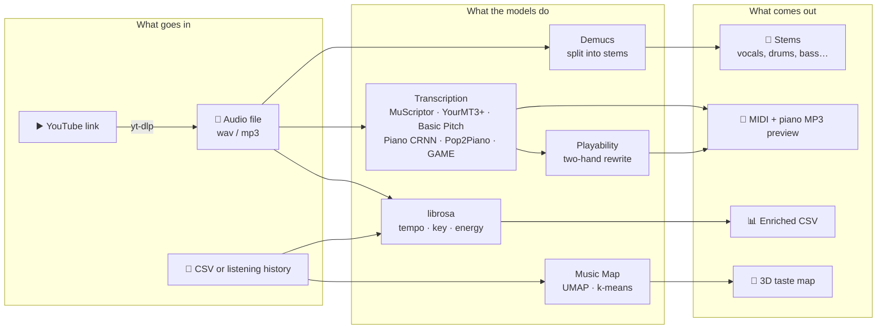

Almost all the "intelligence" comes from **pretrained models** written by research groups (Spotify, Meta, ByteDance, Kyutai, and others). This project doesn't train neural networks. What it does is the part most real ML engineering is made of: choosing models, wiring them into a product, tuning their settings, combining them, and **measuring** them honestly.

---

## 0. Where things stand (October 2026)

| Area | State |
|---|---|
| Running it | `docker compose up --build` starts everything. Add `docker-compose.gpu.yml` on an NVIDIA GPU. MuScriptor needs a free Hugging Face token (`HF_TOKEN` in `.env`) |
| Audio → MIDI | Works. **MuScriptor** is the default full-band engine: on real pop songs it scores 0.47 overall F1, against 0.35 for YourMT3+ and 0.14 for Basic Pitch. **Piano** mode is near perfect on solo piano (0.97) |
| Voices | The singer becomes a clean "Lead vocal" track. **GAME**, a singing-only model, is wired in for Full band and Auto, and is being benchmarked against MuScriptor's own voice track |
| Playable piano | "Playable by two hands" and "Piano cover" (Pop2Piano) work; every MIDI job also returns a piano MP3 preview |
| Stems, CSV, YouTube download | Work end to end. YouTube download has no screen in the UI yet (API only) |
| Music Map | Works from a CSV or Spotify / Apple Music exports. Genres now roll Spotify's detailed tags (e.g. "pop rap") into ~20 broad genres, with an online lookup (Last.fm, MusicBrainz) for songs that have none |
| Research | Learned music models group songs by genre far better than the map's own features: **CLAP** 39% and **MERT** 29% same-genre neighbours, against 16% for the map. Adding a CLAP vector per song to the map is the likely next step |
| Not done | Jobs and accounts live in memory (lost on restart), no job queue, no login screen, no deploy setup. Full list in the [roadmap](roadmap.md) |

Audio and MIDI files (`*.mp3`, `*.mid`, `*.midi`) are git-ignored, so test songs and results never get committed.

---

## 1. Machine learning for audio, in ten minutes

### Sound is a list of numbers

A `.wav` file is a list of numbers: the air pressure measured 22,050 or 44,100 times a second (the **sample rate**). A 3-minute song at 44.1 kHz is about 8 million numbers. That's the top panel below.

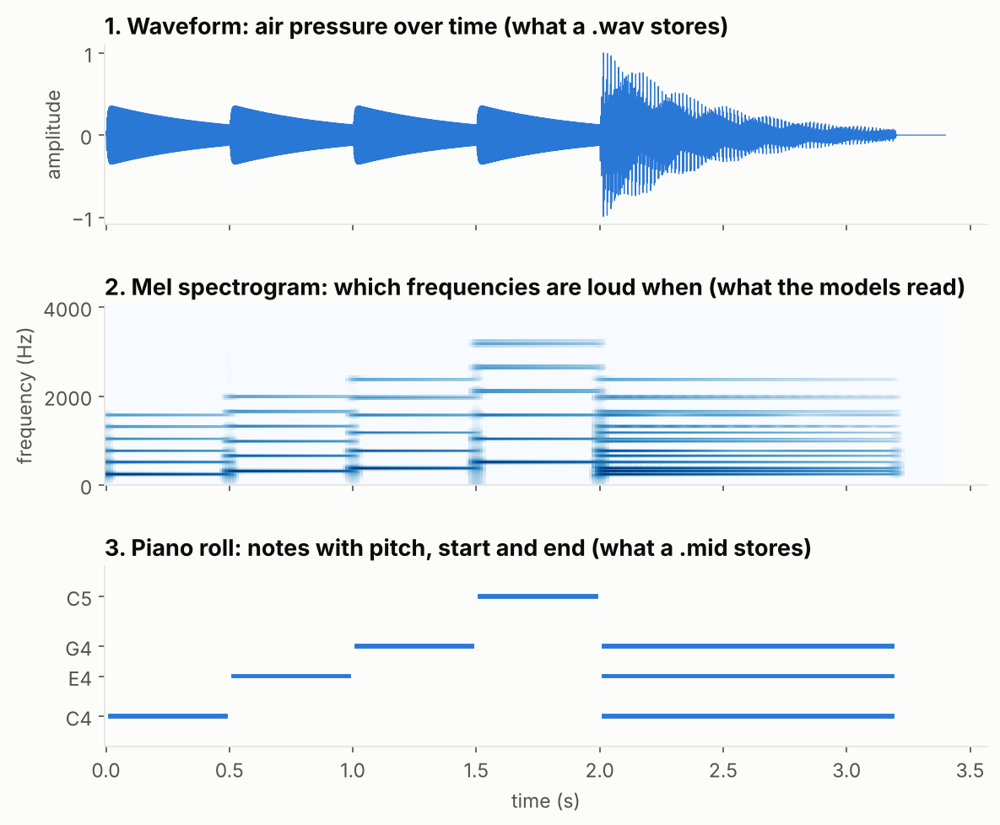

*Generated by [`scripts/make_guide_figures.py`](../scripts/make_guide_figures.py): a synthetic C major arpeggio followed by a chord.*

Raw samples are hard to learn from, because a single note is a fast wiggle whose shape depends on the instrument. So almost every audio model first converts sound into a **spectrogram** (middle panel):

1. Cut the audio into short overlapping windows (for example 2,048 samples, moving 256 at a time).
2. Run a **Fourier transform** on each window. It tells you how much energy is at each frequency.
3. Stack the results side by side. Now you have an image: time on the x-axis, frequency on the y-axis, loudness as brightness.

A **mel spectrogram** squashes the frequency axis to match human hearing (we hear the difference between 100 and 200 Hz far better than between 5,000 and 5,100 Hz). A **constant-Q transform (CQT)** spaces the bins so each musical semitone gets the same number of bins, which is handy for pitch.

Look at the middle panel: each note is not one line but a stack of lines. The lowest is the **fundamental** (the pitch you hear), and the ones above are **harmonics** at 2×, 3×, 4× that frequency. A transcription model has to learn that "a stack of lines spaced like this is one note C4", even when several stacks overlap in a chord. That's the core difficulty of music transcription.

The bottom panel is the target: a **piano roll**, which is what a MIDI file stores. Each note is just `(pitch, start time, end time, velocity)`.

> **Key idea.** Once audio is a spectrogram, it's an image, and ideas from computer vision (convolutions, U-Nets) and from language (Transformers that read and write sequences of tokens) carry over directly. Every model in this project is one of those two families.

### What a "model" is

A neural network is a function with millions of adjustable numbers (**weights**). **Training** shows it many examples of inputs with known answers (audio plus the MIDI that was actually played) and nudges the weights to reduce the error. That's expensive: days of GPU time and a big labelled dataset. **Inference** is just running the trained function on new input, which is what SuperMusic does. The files downloaded on first use (`piano_transcription.pth`, YourMT3+'s `last.ckpt`, Pop2Piano's, MuScriptor's and GAME's weights) are those trained weights.

Some weights come with conditions. MuScriptor's are **gated** on Hugging Face: you accept the licence on the website, then prove who you are with a token (`HF_TOKEN`). MuScriptor's and GAME's licences are non-commercial (CC BY-NC), which matters if this ever becomes a paid product.

### Four kinds of output you'll see

| Kind | Example in this project | Typical model |
|---|---|---|
| **Frame-wise probabilities** ("is pitch 60 sounding at frame 812?") | Basic Pitch, Piano CRNN | Convolutional / recurrent network, then thresholds |
| **A generated sequence of tokens** ("note-on 60, time 0.52, note-off 60…") | MuScriptor, YourMT3+, Pop2Piano | Transformer encoder–decoder, like a translation model |
| **A new waveform** (the drums alone) | Demucs | U-Net plus Transformer, outputs audio |
| **An embedding** (one vector that sums up a song) | MERT, CLAP (research only so far) | Transformer trained without labels (MERT) or to match text (CLAP) |

---

## 2. The system: one backend, three model servers, and a job pattern

### Services

`docker compose up` starts six containers ([`docker-compose.yml`](../docker-compose.yml)):

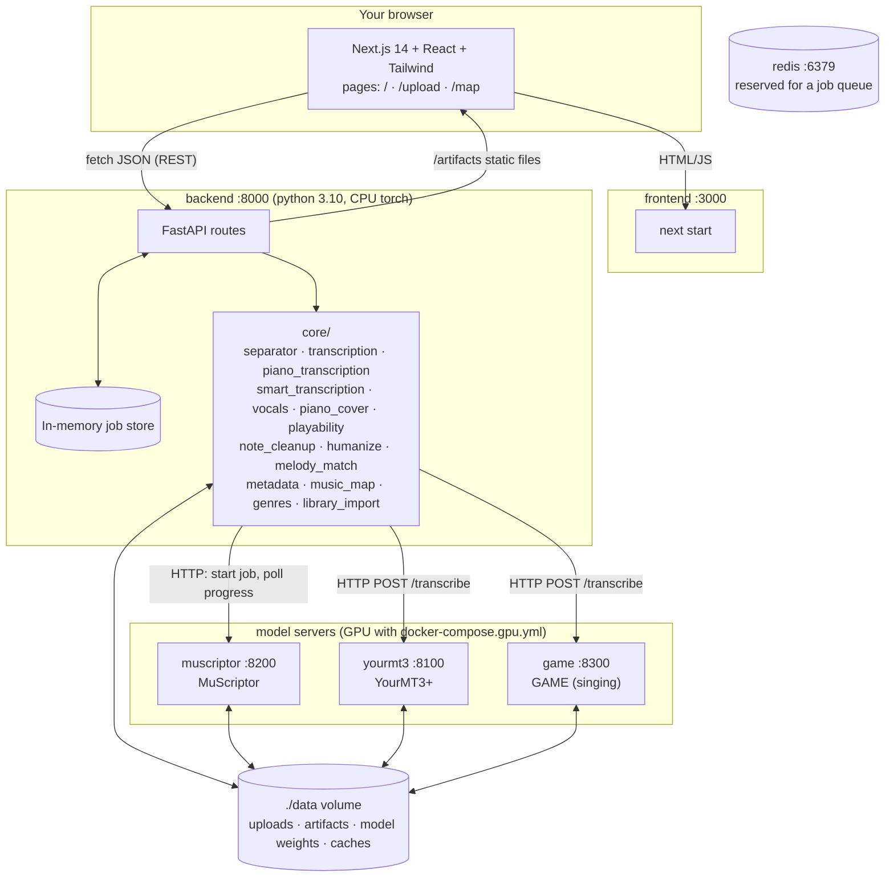

- **frontend**: a Next.js app. It is mostly client-side React and calls the backend directly with `fetch` ([`frontend/lib/api.js`](../frontend/lib/api.js)). The Music Map's 3D view uses `react-force-graph-3d`, which renders with three.js (WebGL).
- **backend**: a FastAPI app ([`backend/app/main.py`](../backend/app/main.py)). Each area (`midi`, `stems`, `csv`, `map`, `upload`, …) is a router in `backend/app/routes/`, and the real work lives in `backend/app/core/`. Basic Pitch, the Piano model, Demucs and Pop2Piano run here, on CPU.
- **muscriptor**, **yourmt3**, **game**: one small Python server per heavy model ([`services/`](../services)). Each loads its model once and answers HTTP requests. The backend checks whether each is reachable and falls back to the next best option if not.
- **redis**: running, but not used yet. It is reserved for a proper job queue (see the [roadmap](roadmap.md)).

**Why does each big model get its own container?** Three reasons, all common in real ML systems:

1. **Dependency conflicts.** YourMT3+ only works with `transformers==4.40.2` (newer versions changed the T5 code it depends on), while the backend's Pop2Piano needs a newer `transformers`. Python can't load two versions of one library in one process, so each gets its own image.
2. **Hardware.** The backend image installs CPU-only PyTorch to stay small (about 3.4 GB even so). The full-band models are slow on CPU, so their images are built on CUDA PyTorch and get the GPU via [`docker-compose.gpu.yml`](../docker-compose.gpu.yml).
3. **Licences.** MuScriptor and GAME have non-commercial weights. Keeping them in separate services means the core app still works without them.

The services talk over plain HTTP (for example [`core/muscriptor_client.py`](../backend/app/core/muscriptor_client.py)) and share files through the `./data` volume, so only paths cross the wire, never audio bytes.

### Tools under the hood

| Task | Tool | Runs in |
|---|---|---|
| Full-band MIDI | MuScriptor (default), YourMT3+ | their own GPU containers |
| Singing → notes | GAME | its own GPU container |
| General MIDI | `basic-pitch` CLI, ONNX model (the TFLite one fails with numpy 2) | backend |
| Piano MIDI | ByteDance piano CRNN (PyTorch) | backend |
| Piano cover | Pop2Piano via Hugging Face `transformers` | backend |
| Stems | `demucs -n htdemucs` (4 stems) or `htdemucs_6s` (6 stems) | backend |
| MIDI → MP3 preview | FluidSynth with a General MIDI soundfont | backend |
| Download | `yt-dlp` (needs updating as YouTube changes) | backend |
| Audio features | librosa: tempo, key, duration, energy | backend |
| Map | umap-learn, scikit-learn | backend |

### The job pattern

ML inference is slow: separating a song takes tens of seconds to minutes, and MuScriptor on a long song can take several minutes. An HTTP request can't just wait that long. So every heavy endpoint follows the same pattern:

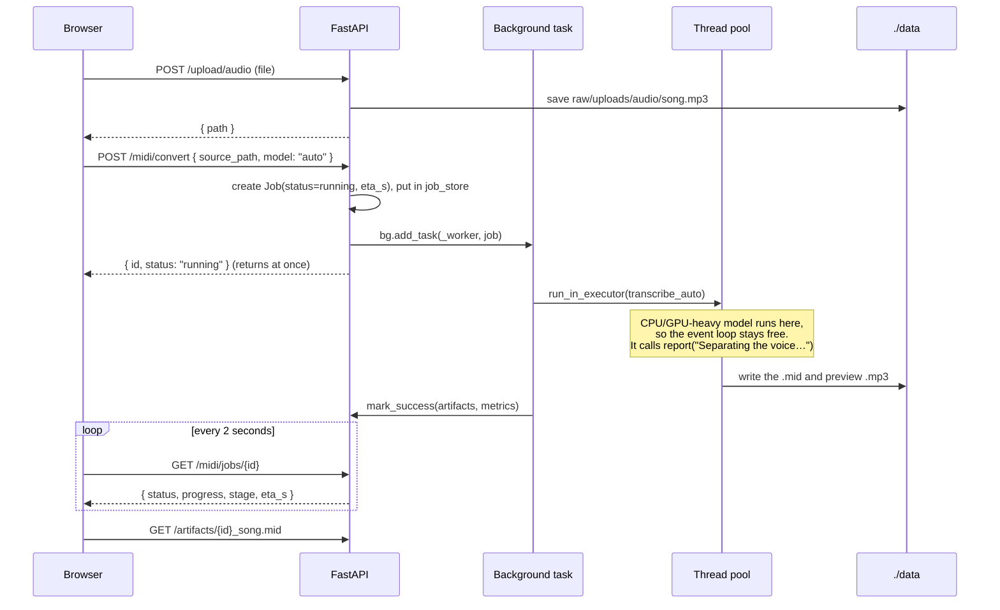

Things to notice in [`routes/midi.py`](../backend/app/routes/midi.py):

- FastAPI is **async**: one event loop serves many requests. Calling a slow, CPU-bound model directly inside an `async def` would freeze the whole server, so the worker hands it to a **thread pool** with `loop.run_in_executor(None, run)`.
- **Live progress without plumbing.** Pipeline code deep inside `core/` calls `report("Transcribing the singing with GAME…")` without knowing about jobs. [`core/progress.py`](../backend/app/core/progress.py) uses a Python `contextvars` variable to know which job is current, and copies that context into the worker thread. The job also gets an `eta_s` estimate from the song's length and the mode's measured speed, so the UI can draw a progress bar. MuScriptor reports "section X of Y" from its own server, which the backend polls the same way the UI polls the backend.
- **Models are loaded once and cached** in a module-level variable (for example `_model` in `piano_transcription.py`), guarded by a `threading.Lock`. Loading weights takes seconds and hundreds of MB of RAM; doing it per request would be slow and could run out of memory. The lock also serialises inference, because these models aren't thread-safe.
- **Weights download lazily** on first use into `data/models/`, which is a mounted volume, so they survive container rebuilds.
- The job store is a Python `dict` ([`utils/storage.py`](../backend/app/utils/storage.py)). That's simple, but restarting the backend forgets every job, and it can't scale to several backend processes. The UI notices when a job it was polling disappears and marks it **Lost** with a **Try again** button. Moving jobs to Redis or a database is the top item on the [roadmap](roadmap.md).
- The frontend's polling lives in [`hooks/useUploadJobs.js`](../frontend/hooks/useUploadJobs.js) (`setInterval(..., 2000)`). A WebSocket route exists (`routes/websocket.py`) as the push-based alternative but isn't used by the UI.

### Where the code lives

| Path | What it is |
|---|---|
| `backend/app/routes/` | HTTP endpoints. Thin: validate input, start a job, return it |
| `backend/app/core/` | The actual audio/ML code. Each file is usable on its own, without FastAPI |
| `backend/app/models/job.py` | The `Job` Pydantic model every long task returns |
| `services/muscriptor/`, `services/yourmt3/`, `services/game/`, `services/clap/` | The model servers (YourMT3+ also carries the authors' model code under `amt/`) |
| `frontend/pages/` | `index.js` (home), `upload.js` (the Workspace), `map.js` (Music Map) |
| `frontend/components/map/Graph3D.js` | The 3D map renderer |
| `scripts/` | Benchmarks (`eval_*.py`), comparisons (`compare_*.py`), dataset builders (`build_*.py`), and `make_guide_figures.py` for this guide's charts |
| `legacy/` | Older prototype code, kept for reference and not used by the app |

> **Lesson:** keeping `core/` free of web-framework code is what makes the evaluation scripts possible. `scripts/eval_transcription.py` imports the same `transcribe_piano` function the API calls, so the benchmark measures exactly what users get. Since `scripts/` is mounted into the backend container, a pulled script fix applies without rebuilding the image.

---

## 3. Audio to MIDI: seven modes and a voice model

Turning recorded audio into notes is called **automatic music transcription (AMT)**. It's an open research problem, and no single model is best at everything. So the Workspace offers several modes, plus **Auto**, which picks one. Each mode is a function in `backend/app/core/` that takes an audio path and returns a MIDI path.

| Mode in the UI | API `model` | Engine | Best for |
|---|---|---|---|
| Auto (default) | `auto` | picks one of the below | anything |
| Full band | `muscriptor` | MuScriptor | pop and band mixes |
| Full band (YourMT3+) | `multi` | YourMT3+ | bands, about 3× faster than MuScriptor |
| Stems | `stems` | Demucs + one tool per stem | when no full-band server is running |
| Piano | `piano` | ByteDance CRNN | solo piano |
| General | `basic` | Basic Pitch | one instrument, fast |
| Piano cover | `cover` | Pop2Piano | a piano arrangement of a song |

### 3.1 Stem separation with Demucs

**What it does:** splits a mixed song into separate audio tracks ("stems"). The 4-stem model `htdemucs` gives vocals, drums, bass, other; the 6-stem `htdemucs_6s` adds guitar and piano.

**The model:** Hybrid Transformer Demucs (Meta AI, Rouard et al., 2023). It's a **U-Net**: an encoder shrinks the input step by step into a compact representation, and a decoder grows it back to full size, with **skip connections** that copy detail from each encoder level to the matching decoder level. "Hybrid" means it runs two U-Nets at once, one on the raw waveform and one on the spectrogram, with a **Transformer** in the middle that lets the two branches exchange information. Its output is one waveform per stem.

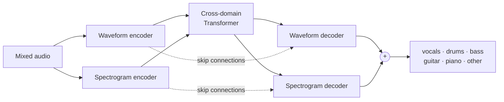

**In the code:** [`core/separator.py`](../backend/app/core/separator.py) runs the `demucs` command-line tool with `subprocess.run` and collects the `.wav` files it writes. Wrapping a CLI is a perfectly good way to integrate a model: the tool's authors handle loading, chunking and overlap-add. A finished stem job can be reused by a MIDI job (`stem_job_id`), and you can pick which stems to transcribe.

**What to learn:** separation is never perfect. Our own benchmark found that Demucs' piano stem **smears** notes: transcribing the separated piano scored 0.66 F1, while transcribing the full mix with the piano model scored 0.87. Separating the voice before running a full-band model also made the band's notes *worse*. Chaining models multiplies their errors; always measure the chain, not just each piece.

### 3.2 General mode: Basic Pitch

**What it does:** turns any single-instrument or simple recording into MIDI, quickly.

**The model:** Basic Pitch (Spotify, Bittner et al., 2022). A deliberately tiny **convolutional network** (under 20,000 weights) that reads a **harmonic CQT**: the CQT stacked with copies of itself shifted by each harmonic, so a note's harmonics line up vertically and a small convolution can spot them. It outputs three images the same size as the input: the probability that a **note onset** happens at each pitch and frame, that a **note is sounding**, and a fine-grained **pitch contour** (for vibrato and bends). A post-processing step turns those images into notes.

**The interesting part is the thresholds.** Post-processing has knobs: how confident an onset must be (`onset_threshold`), how confident a frame must be to keep a note going (`frame_threshold`), and the shortest note to keep. These are **hyperparameters**: settings chosen by people, not learned. We tried 36 combinations on MAESTRO's *validation* split and picked the best (onset 0.6, frame 0.3, min note 58 ms). On the separate *test* split, note F1 went from **0.70 to 0.75** without touching the model ([`core/config.py`](../backend/app/core/config.py)). Basic Pitch's "melodia trick", which adds notes where a pitch keeps ringing, is off by default: on two piano covers it mostly added wrong notes.

**What to learn:** a classifier outputs probabilities, and turning them into decisions with a threshold trades **precision** against **recall** (Part 6). Tuning on one split and reporting on another is the basic discipline that keeps you from fooling yourself.

### 3.3 Piano mode: the MAESTRO-trained CRNN

**What it does:** transcribes solo piano very accurately, including how hard each key was hit (**velocity**) and the **sustain pedal**.

**The model:** "High-resolution piano transcription with pedals" (ByteDance, Kong et al., 2021). A **CRNN**: convolutional layers read the log-mel spectrogram, then bidirectional GRU (recurrent) layers read it as a sequence, so each frame's decision can use context from before and after. Its trick is to **regress** the exact onset and offset time inside each 10 ms frame instead of just classifying frames, so timing is precise. Separate heads predict velocity and pedal.

It was trained on **MAESTRO**: about 200 hours of concert pianists playing a Yamaha Disklavier, a real piano that records every key and pedal movement as MIDI. Because the MIDI comes from the instrument itself, the labels are near-perfect. That's why piano transcription is far ahead of other instruments: the quality of a model is capped by the quality of its labelled data.

**In the code:** [`core/piano_transcription.py`](../backend/app/core/piano_transcription.py) downloads the ~170 MB checkpoint once, loads it onto the GPU if there is one (`torch.cuda.is_available()`), and runs it.

**Result:** note F1 **0.974** on solo piano, against 0.75 for General. The honest caveat: it was trained on MAESTRO and we tested on MAESTRO's held-out test pieces, so this is its best case. A home recording on an upright piano will score lower. That gap between training data and real data is called **distribution shift**.

### 3.4 Full band: MuScriptor (the default)

**What it does:** transcribes every instrument in a full mix at once, writing one MIDI track per instrument (vocals, piano, guitar, bass, strings, drums…).

**The model:** MuScriptor (Kyutai and Mirelo, 2026). Like MT3 and YourMT3+ below, it treats transcription as **translation**: audio in, a sequence of MIDI-like **tokens** out, generated one token at a time (**autoregressive** decoding, the same way a language model writes text). What sets it apart is its training data: about 1.45 million MIDI files rendered to audio with many instrument sounds, plus about 11,000 hours of real recordings with aligned notes. Its authors report that adding the real recordings raised every score by about 20 points over a synthetic-only version. We run the 307M-parameter "medium" size, which fits in the RTX 2060's 6 GB.

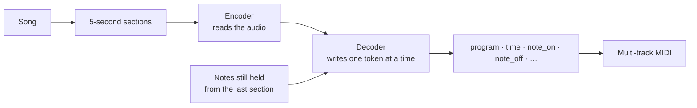

Things worth knowing:

- **Sections and "prelude".** The song is cut into 5-second sections. Each section's decoder is first told which notes are still sounding from the previous one, so a held chord isn't cut at the boundary. `MUSCRIPTOR_FAST=1` instead runs 4 sections at once on the GPU without that hand-off: about 30% faster, but every held note stops at each 5-second join, which you hear as a hiccup. It is off by default.
- **Beam search.** By default the decoder takes the single most likely token each step (**greedy**). Beam search keeps the best few partial sequences and picks the best whole one at the end: slower, sometimes more accurate. `scripts/eval_pop.py` can compare both.
- **Post-processing in our code.** MuScriptor writes notes at flat loudness, so [`core/humanize.py`](../backend/app/core/humanize.py) gives them dynamics that follow the song's own loudness, and adds sustain pedal only on piano tracks.

**Result:** on real pop songs (MulTTiPop, Part 6) MuScriptor gets **0.47 overall F1** against 0.35 for YourMT3+ and 0.14 for Basic Pitch, and it's the best on drums too. It's about 3× slower than YourMT3+ (roughly 0.8 s per second of music on an RTX 2060). It hasn't been tested on solo piano, so Auto still sends solo piano to the Piano model.

### 3.5 Full band (YourMT3+): the previous default

**The model:** YourMT3+ (Chang et al., 2024), an improved version of Google's MT3, and the clearest example in this repo of the encoder–decoder idea:

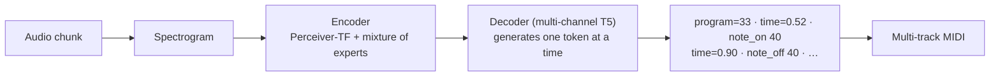

- **Tokens.** The output vocabulary has tokens for time shifts, note-on/off, pitch, and instrument ("program"). Generating MIDI becomes next-token prediction, the same objective as GPT-style models.
- **Mixture of experts (MoE).** Some layers contain 8 small sub-networks ("experts"), and a router sends each input to the best 2. You get the capacity of a big model at the compute cost of a smaller one.
- **Multi-channel decoding.** Instead of one long token stream for all instruments, the decoder writes several streams in parallel, one per instrument group, which keeps sequences short.
- **Precision tricks.** The RTX 20-series has no bfloat16, so the server runs in float16 on GPU and float32 on CPU ([`services/yourmt3/server.py`](../services/yourmt3/server.py)). Lower precision halves memory and speeds things up at a small accuracy cost.

**Result:** 0.96 note F1 on solo piano, 0.92 on piano inside a band, and 0.69 on classical ensembles (MusicNet), better than Basic Pitch or Stems everywhere. On real pop, MuScriptor beats it, so it's now the fallback when MuScriptor isn't available or fails.

**What to learn:** the model that wins on one benchmark (piano, classical) can lose on the one your users care about (pop). We only found out because we built a pop benchmark.

### 3.6 Piano cover mode: Pop2Piano

**What it does:** this one doesn't transcribe. It **arranges**: given a pop song, it writes what a pianist would play to cover it, with melody on top and accompaniment underneath.

**The model:** Pop2Piano (Choi & Lee, 2023), a **T5 Transformer** encoder–decoder trained on about 300 hours of pop songs paired with piano covers that people posted on YouTube. Like the full-band models, it outputs MIDI tokens. It also takes a **conditioning token**, `composer1` to `composer21`, telling it which of 21 cover arrangers' styles to imitate. Changing that one input changes the arrangement, which is a simple, visible example of a **conditional generative model**.

**In the code:** [`core/piano_cover.py`](../backend/app/core/piano_cover.py) loads it through Hugging Face `transformers` (`Pop2PianoForConditionalGeneration` plus `Pop2PianoProcessor`), calls `model.generate(...)`, and decodes the tokens into a `pretty_midi` object. Pop2Piano writes every note at one loudness with no pedal, so `humanize.py` adds dynamics and pedal that follow the original song.

**What to learn:** transcription and arrangement are different tasks with different "right answers". Transcription has one correct output (what was played) and can be scored with F1. An arrangement has many good outputs, so F1 against the original makes no sense; we compare it on playability instead ([`scripts/compare_piano_cover.py`](../scripts/compare_piano_cover.py), results in [playable-piano.md](playable-piano.md)).

### 3.7 Stems and Auto: combining models

**Stems mode** ([`core/smart_transcription.py`](../backend/app/core/smart_transcription.py)) is a pipeline: separate with `htdemucs_6s`, then send each stem to the best tool for it, and merge everything into one multi-track MIDI with General MIDI instrument numbers. Drums don't have pitches, so they go through a hand-written detector instead of a model: find **onsets** (sudden jumps in energy) with `librosa.onset.onset_strength` and `scipy.signal.find_peaks`, then classify each hit by where its energy sits in the spectrum (low → kick, high → hi-hat, middle → snare). That's classic signal processing, and worth reading next to the neural models.

**Auto mode** is a small **router**. It separates just 30 seconds from the middle of the song (intros are often unrepresentative), measures each stem's share of the total energy (sum of squared samples), and applies rules (`choose_model`):

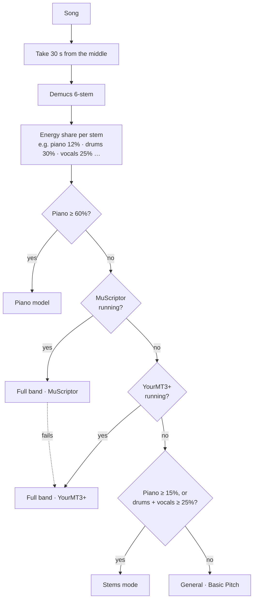

Each branch exists because a benchmark showed that model winning in that situation. This is a **rule-based ensemble**, and it's often the most practical way to get the best of several models without training a new one.

### 3.8 Voices: the Lead vocal track and GAME

A transcriber hears a singer as just another instrument. Our leakage test ([transcription-accuracy.md](transcription-accuracy.md#voices)) found Basic Pitch writing up to 195 notes a minute on the singer's pitch, spread over guitar, strings and synth tracks. So with **Voice as its own melody** (on by default), [`core/vocals.py`](../backend/app/core/vocals.py) gives the singer a track of their own:

- **General:** Demucs separates the voice first; the backing is transcribed without it, and the voice becomes the Lead vocal.
- **Full band and Auto:** the band is transcribed from the full mix (separating first made it worse). If the **GAME** service is running, the voice is then separated and transcribed by GAME, which replaces the band model's own voice track. Otherwise the band model's singing tracks are folded into one Lead vocal. Either way the band model's own voice notes are kept as a second track, **Song sound (as heard)**: on rap the model tends to put the beat and sample into its "voice", which is useless as a melody but sounds the most like the song (Meek Mill "WHO DECIDES WAR": melody match 2.4% vs 57% for the Lead vocal, yet it sounded better). Mute one or the other in the player.
- In every mode the Lead vocal is cleaned up: one note at a time (the strongest wins), blips under 80 ms dropped, tiny gaps merged, and notes far from the melody's centre (bass bleed, octave errors) removed.

**GAME** (openvpi, MIT code, CC BY-NC-SA weights) is a model trained only on singing. A specialist like this should follow a voice's slides and vibrato better than a general model that also has to listen for drums. Whether it actually does is being measured now: `scripts/eval_pop.py` scores the Lead vocal on MulTTiPop clips that have a vocal part (`muscriptor_vocal` against `muscriptor_game`). Rap has no fixed pitch, so its "melody" follows the speaking voice's rise and fall.

### 3.9 Finishing touches on every MIDI job

- **Repeated notes stay separate** ([`core/note_cleanup.py`](../backend/app/core/note_cleanup.py)). Every engine ends a re-struck note exactly when the next press starts, so two presses of one key drew as one long bar. A real key has to come up before it's struck again, so each note that runs into the next press of the same key is shortened to leave a 30 ms gap (never by more than half its length).
- **A piano MP3 preview.** FluidSynth renders the MIDI with a real piano soundfont, because a computer's built-in MIDI player makes anything sound cheap.
- **Melody match** (Part 6): when the voice was separated, the job also scores how much of the sung melody the MIDI got right.

---

## 4. Making MIDI playable: an algorithm, not a model

A transcription of a band can have 10+ notes sounding at once across four octaves. No human can play that. The **Playable by two hands** option ([`core/playability.py`](../backend/app/core/playability.py)) rewrites the MIDI so that at every moment each hand holds at most 5 notes within one stretch (an octave, a ninth or a tenth).

It's a **greedy algorithm** over time, not a neural network:

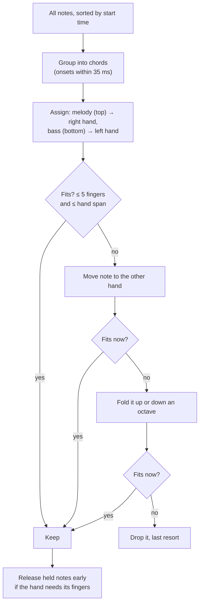

**How do you test an algorithm like this?** You need ground truth for "playable". MAESTRO's MIDI is exactly what real pianists played, so it should score near 100%, and it does (99.9% at a ninth). That **validates the metric**. Then a deliberately unplayable input (three pieces layered on top of each other) shows what the rewrite achieves:

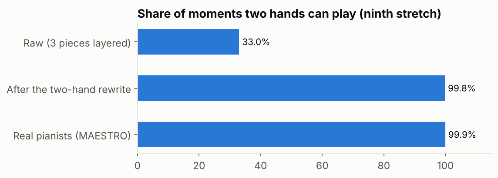

**What to learn:** not every problem needs ML. When the rules are known (hands have five fingers and a fixed reach), a clear algorithm is more predictable, faster and easier to debug than a model. What the algorithm can't do is *arrange with taste*, and that's where a learned model (Pop2Piano) earns its place. For full songs, **Piano cover + Playable by two hands** gives the most playable result ([playable-piano.md](playable-piano.md)).

---

## 5. The Music Map: unsupervised learning on your library

The Music Map ([`core/music_map.py`](../backend/app/core/music_map.py), user guide in [music-map.md](music-map.md)) takes a list of songs and draws them as a 3D constellation where similar songs sit close together, grouped into clusters with plain-language names.

There are no labels here: nobody tells the system which songs belong together. Finding structure in unlabelled data is **unsupervised learning**. The pipeline:

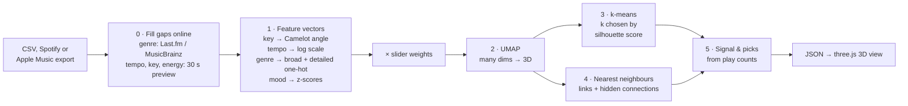

### Step 0: filling the gaps

A Spotify or Apple Music listening history only has artist, title and play times. [`core/library_import.py`](../backend/app/core/library_import.py) fills in the rest:

- **Genre** comes from listener tags ([`core/genres.py`](../backend/app/core/genres.py)): Last.fm if you set a free `LASTFM_API_KEY`, otherwise MusicBrainz, and Deezer's album genre only as a last resort (Deezer files whole albums under one coarse genre and calls a lot of non-rap music "Rap/Hip Hop", which once made the whole map look like rap).
- **Tempo, key, energy and brightness** come from analysing the song's 30-second Deezer preview with librosa on your machine. Key uses the **Krumhansl–Schmuckler** method: correlate the song's average pitch-class profile with a profile for each of the 24 keys and pick the best match.
- Lookups are cached per artist, and only titles and artists leave your machine.

### Step 1: feature engineering

A model can only compare numbers, so each song becomes a vector. *How* you turn things into numbers decides what "similar" means, and that's the most important design decision in the whole map:

- **Musical key** isn't a number on a line. C major and G major sound compatible, but C and C# don't. DJs use the **Camelot wheel**, where neighbours mix well. So each key becomes a point on a circle: `(cos θ, sin θ)`, with θ from its Camelot number, plus ±0.6 for major/minor. Now 12 and 1 end up next to each other, as they should.
- **Tempo** goes on a **log scale**, so 90 vs 100 BPM counts as much as 135 vs 150. For "hidden connections" it's also **folded by octaves** (angle = log₂(BPM) mod 1), so 87 BPM neo-soul lands exactly on 174 BPM drum & bass (half time).
- **Genre** becomes **one-hot** columns (one per genre, 1 if the song has it), normalised so a song with three genres doesn't outweigh one with one. Spotify-style detailed tags ("toronto rap, pop rap, canadian pop") are also rolled up into one or two of about 20 **broad genres** (Hip-Hop, Pop, …). The broad genres carry most of the weight and name the clusters, so one detailed tag shared by many artists can't label everything. Mapping a messy vocabulary onto a small fixed one is a typical **data cleaning** job, done here with ordered rules (specific ones such as "pop rap" before broad ones such as "pop").
- **Mood** columns (energy, valence, danceability…) are **z-scored**: subtract the mean, divide by the standard deviation, so every column is on the same scale and none dominates just because its numbers are bigger.

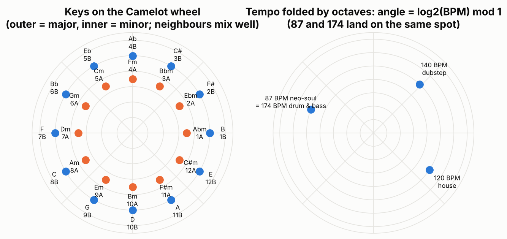

The sliders in the UI multiply each block by a weight (0× to 2×), so a user is literally editing the distance function.

### Step 2: dimensionality reduction with UMAP

The vectors have dozens of dimensions (one per genre, plus key, tempo, mood…). To draw them, **UMAP** squeezes them into 3D while trying to keep each point's nearest neighbours nearby. It builds a graph of who's close to whom in high dimensions, then finds a 3D layout with a similar graph. For under 12 songs there isn't enough data for UMAP, so the code falls back to **PCA**, a linear method that projects onto the directions of greatest variance.

UMAP preserves **local** structure (who's next to whom) much better than **global** structure (how far apart two clusters are). So on the map, closeness means something, but the distance between distant clusters, and the axes themselves, don't.

### Step 3: clustering with k-means

**k-means** splits points into k groups: pick k centres, assign each point to the nearest centre, move each centre to the mean of its points, repeat. But how many clusters? The code tries k = 2 to 10 and keeps the one with the best **silhouette score**, which compares each point's distance to its own cluster against its distance to the nearest other cluster (+1 = clearly in the right group, 0 = on a border).

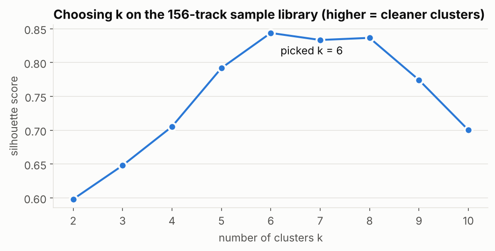

*This chart runs the real `_prepare` and `_embed_3d` functions on the bundled 156-track sample library, which has 8 genres. The score prefers 6 clusters: a couple of genres are close enough in key, tempo and mood to share a cluster, which is the map doing its job of grouping by sound rather than by label.*

### Steps 4 and 5: links, hidden connections and recommendations

- **Links** come from **k-nearest neighbours** in the original feature space (scikit-learn's `NearestNeighbors`), not the 3D layout, so they reflect real similarity rather than projection artefacts.
- **Hidden connections** use a second "musical only" space (key, folded tempo, mood) and keep pairs that are close there but sit in **different** clusters. That's how a lo-fi track and a jazz track in the same key and half-time tempo get linked.
- **Signal** is a ratio: a cluster's share of your listening divided by its share of your library. A cluster that's 14% of your songs but 20% of your plays has a **lift** of 1.43×.
- **Recommendations** average your most-played tracks into a "taste centre" vector, then rank your least-played tracks by distance to it. That's a tiny **content-based recommender**. Recommending songs *outside* your library needs a catalogue to search, which is on the [roadmap](roadmap.md).

### Could a learned embedding do better? The MERT and CLAP experiment

The map's features are hand-designed: key, tempo, genre tags, a few mood numbers. A different approach is to let a model listen and produce an **embedding**, one vector per song, where similar-sounding songs land close together. [`scripts/compare_embeddings.py`](../scripts/compare_embeddings.py) compared three descriptions of the same 560 songs (30-second Deezer previews from 14 chart genres):

- **map**: the map's own features, computed from the audio
- **MERT** (`m-a-p/MERT-v1-95M`): a **self-supervised** music model. It was trained without any labels, by hiding parts of the audio and predicting what was hidden (like BERT does with words). To do that well it has to learn pitch, rhythm, timbre and style.
- **CLAP** (`laion/clap-htsat-unfused`): a **contrastive** model trained on pairs of audio and text descriptions, pulling each clip's vector towards its own caption and away from the others. Audio and text end up in the same space, so you can search songs with words.

Each model outputs a vector for every fraction of a second; we average over time to get one vector per song, which keeps what the song sounds like and drops where each sound happens. The score is: of each song's 10 nearest neighbours (by other artists), how many share its genre?

| Space | Neighbours sharing the song's genre |
|---|---:|
| map | 16.3% |
| MERT (average of all layers) | 28.9% |
| MERT layer 7 (best) | 34% |
| **CLAP (clap-htsat-unfused)** | **38.7%** |
| CLAP (larger_clap_music, first run) | 15.5%, broken |
| random | 7.1% |

- **Both learned models beat the hand-made features by a wide margin**, without ever being told about genres. CLAP's text search also works: "sad slow piano ballad" returns Yiruma and a Schubert impromptu.
- **MERT's middle layers do best**; the last layers are tuned to MERT's training task rather than to overall sound. This "middle layers make the best general features" pattern shows up in language and vision models too.
- **The map and the models mostly disagree** about which songs are neighbours (under 9% shared, against 1.8% by chance). Key, tempo, loudness and brightness are a thin description of a song.
- **When a result is suspiciously bad, suspect the setup before the idea.** The first CLAP checkpoint returned the same five songs for every text query. Rather than conclude "CLAP doesn't work", the script gained health checks (missing weights, whether all songs collapse to one vector, a zero-shot genre test), and a different checkpoint scored best of all.
- The genre labels are marketing labels and noisy, so absolute numbers are low for every space. Compare the spaces with each other, not with 100%.
- **Linear CKA** is also reported: a single number for how similar two whole spaces are. Neighbour overlap turned out to be more useful because it's what the map actually shows.

The likely next step is to add a CLAP vector per song to the map as an optional "sound" feature with its own slider. Full numbers and rerun commands are in [music-map.md](music-map.md#research-would-a-music-model-map-better).

---

## 6. Measuring: how we know any of this works

Without measurement, ML work is guesswork. Every claim in this project's docs comes from a script you can re-run. Full tables are in [transcription-accuracy.md](transcription-accuracy.md).

### Precision, recall and F1

A transcription is compared note by note with the **reference** (the notes that were actually played). A predicted note counts as correct if its pitch matches and it starts within **50 ms** of a reference note. Each reference note can only be matched once.

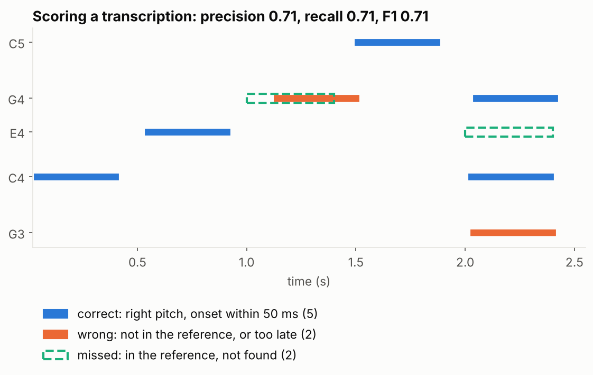

- **Precision** = correct ÷ everything predicted. "When it writes a note, how often is it right?" Extra notes lower it.
- **Recall** = correct ÷ everything in the reference. "How many of the real notes did it find?" Missed notes lower it.
- **F1** = 2 × P × R ÷ (P + R), the harmonic mean. It's high only when both are high, so you can't cheat by predicting nothing (perfect precision, zero recall) or everything (perfect recall, terrible precision).
- **Note + offset F1** also requires the note to *end* at the right time (within 20% of its length or 50 ms). All models score low here because the sustain pedal makes "when does a note end" ambiguous.

The scoring uses `mir_eval`, the standard library for music evaluation, so our numbers are comparable to published papers.

### The benchmarks

Each benchmark answers a different question, from easiest to closest to real use:

| Benchmark | Script | Question | Headline result |
|---|---|---|---|
| Solo piano (MAESTRO test, 20 pieces) | `eval_transcription.py` | How good is each model on clean piano? | Piano 0.97, YourMT3+ 0.96, General 0.75 |
| Piano in a band (MAESTRO + mixed-in backing) | `eval_mix.py` | Can it find the piano under drums and guitar? | YourMT3+ 0.92, Piano / Stems 0.87, General 0.47 |
| Classical ensembles (MusicNet, 10 recordings) | `eval_musicnet.py` | Real multi-instrument recordings none of the models trained on | Auto 0.70, YourMT3+ 0.69, General 0.52 |
| **Real pop (MulTTiPop, 169 clips)** | `eval_pop.py` | What users actually feed in | **MuScriptor 0.47**, YourMT3+ 0.35, General 0.14 |
| Voice leakage (4 real songs) | `eval_vocal_leakage.py` | How many "instrument" notes are really the singer? | General up to 195 per minute on the voice's pitch |
| Playability (40 MAESTRO pieces) | `eval_playability.py` | Does the playability score call real piano playable? | 99.9% |

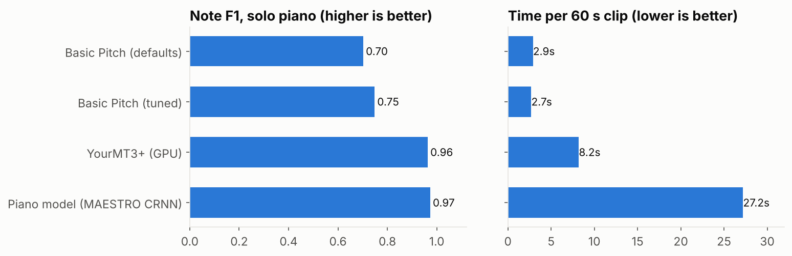

Notice the trade-off between accuracy and speed: the piano specialist is the most accurate but about 10× slower than Basic Pitch on the same hardware. Which one is "best" depends on whether the user is waiting for it.

**Piano inside a band** builds its own test set: it mixes a drums + bass + guitar backing under MAESTRO clips at equal loudness, so we know the exact piano notes even though the audio now sounds like a band. This trick of creating labelled data by mixing known sources is called **data synthesis** or **augmentation**.

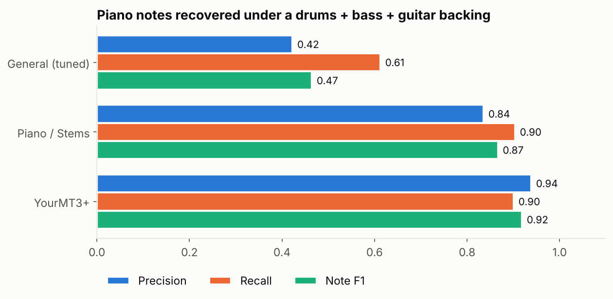

**Real pop** is the hardest and the most important. MulTTiPop (CMU, 2026) ships no audio, only YouTube IDs and hand-checked notes, so `scripts/build_pop_benchmark.py` downloads the clips first. Even the best model finds under half the notes, against 0.97 on solo piano: a full mix hides quiet parts (pads, backing vocals, doubled guitars) under louder ones.

**Robustness check:** re-encoding the piano test clips as 128 kbps MP3 changed scores by less than 0.001. That's a one-line experiment that answers a real user question ("does it matter that my file is an MP3?").

### Melody match: scoring songs that have no answer key

Most songs you'd feed in have no reference MIDI. But the singer *is* an answer key for the melody: once the voice is separated, a pitch tracker can trace which note it's on every 20 ms. [`core/melody_match.py`](../backend/app/core/melody_match.py) lays the MIDI's melody over that trace and reports the share of sung time where the MIDI plays the same note. It shows up under the player in the app, and `scripts/compare_melody.py` compares modes on your own songs. It's a **proxy metric**: cheaper than a hand-made reference, but it only judges the tune, and harmonies leaking into the vocal stem can pull it off.

### Lessons from the benchmarks

1. **Split your data.** Tune on validation, report on test. Tuning Basic Pitch on the test set would have given a better-looking but dishonest number.
2. **Know your model's training data.** The piano model scores 0.97 on MAESTRO because it was trained on MAESTRO recordings. Expect less elsewhere.
3. **Benchmark the system, not just the model.** The Demucs → piano model chain scored worse (0.66) than the piano model alone on the mix (0.87). Only an end-to-end test shows that.
4. **Benchmark on what users actually use.** YourMT3+ won every piano and classical test, then lost clearly to MuScriptor on pop. The default engine changed because of one new benchmark.
5. **Measure before you train.** The project twice decided *not* to train a model (piano fine-tuning, playability) because measurement showed there was nothing left to gain, and it swapped in newer pretrained models (MuScriptor, GAME) before considering training. Training is the expensive last resort, not the first step. The data that *would* help is surveyed in [training-data.md](training-data.md).

---

## 7. What you can learn here, and exercises

| Concept | Where to see it | Try this |
|---|---|---|
| Spectrograms, Fourier transform | `core/metadata.py`, `drums_to_notes` in `core/smart_transcription.py` | Plot `librosa.feature.melspectrogram` of a song you know and find the kick drum hits |
| Using a pretrained model through a CLI | `core/separator.py`, `core/transcription.py` | Run `demucs -n htdemucs_6s song.mp3` yourself and listen to each stem |
| Loading a PyTorch model and caching it | `core/piano_transcription.py` | Time the first and second piano job; explain the difference |
| Hugging Face `transformers` | `core/piano_cover.py` | Generate the same song with `composer1` and `composer15` and compare |
| Model servers over HTTP | `services/muscriptor/server.py`, `core/muscriptor_client.py` | Stop the muscriptor container and watch Auto fall back to YourMT3+ |
| Autoregressive decoding, beam search | `services/muscriptor/server.py` (`beam_size`), `scripts/eval_pop.py` | Run `eval_pop.py --methods muscriptor muscriptor_beam` on 20 clips: is beam search worth its time? |
| Encoder–decoder Transformers, tokens | `services/yourmt3/amt/src/utils/event2note.py`, `note2event.py` | Print the first 50 tokens YourMT3+ generates for a short clip |
| Specialist vs generalist models | `core/vocals.py` (`sung_lead_vocal`), `core/game_client.py` | Compare `muscriptor_vocal` and `muscriptor_game` Vocal F1 with `eval_pop.py` |
| Thresholds and precision/recall | `core/config.py` (`BASIC_PITCH_*`) | Re-run the 36-combination grid with `scripts/eval_transcription.py` and plot precision vs recall |
| Evaluation with held-out data | `scripts/eval_transcription.py`, `scripts/eval_pop.py` | Add a column for velocity accuracy, or score each instrument separately |
| Proxy metrics | `core/melody_match.py` | Run `scripts/compare_melody.py` on five songs and check whether the best-scoring mode also sounds best |
| Rule-based routing / ensembles | `choose_model` in `core/smart_transcription.py` | Change the 60% piano threshold and measure whether Auto gets better or worse |
| Greedy algorithms with constraints | `core/playability.py` | Add a rule that limits how fast a hand can jump, then check MAESTRO still scores ~100% |
| Feature engineering, data cleaning | `_prepare` in `core/music_map.py`, `core/genres.py` | Add `year` as a circular feature by decade and see how the map changes |
| UMAP, PCA, k-means, silhouette | `_embed_3d`, `_cluster` in `core/music_map.py` | Swap k-means for DBSCAN or HDBSCAN and compare cluster quality |
| Embeddings (self-supervised, contrastive) | `scripts/compare_embeddings.py` | Feed CLAP or MERT layer-7 vectors into `build_map` as an extra feature block and look at the clusters |
| Recommenders | `_recommend` in `core/music_map.py` | Replace the "taste centre" average with several centres (one per favourite cluster) |
| Async web APIs with slow work | `routes/midi.py`, `core/progress.py`, `utils/storage.py` | Move the job store into Redis so jobs survive a restart |
| Containers, GPUs, dependency isolation | `Dockerfile`, `services/*/Dockerfile`, `docker-compose.gpu.yml` | Run YourMT3+ on CPU and on GPU and compare the time per clip |

A good order to read the code in:

1. `core/metadata.py` (a short file of librosa: the gentlest start)
2. `core/transcription.py`, then `core/piano_transcription.py` (two ways to run a model)
3. `routes/midi.py` (how a model becomes an API)
4. `core/smart_transcription.py` (combining models, plus classic signal processing)
5. `services/muscriptor/server.py` and `core/muscriptor_client.py` (a model as its own service)
6. `scripts/eval_pop.py` (how it's all measured)
7. `core/music_map.py` (the biggest file, and the only one doing unsupervised learning)

To regenerate the charts in this guide: `python scripts/make_guide_figures.py`.

---

## 8. Glossary

| Term | Meaning |
|---|---|
| **AMT** | Automatic music transcription: audio in, notes out |
| **Autoregressive** | Generating output one piece at a time, each step conditioned on what was written so far |
| **Beam search** | Decoding that keeps the best few partial outputs instead of only the single best next token |
| **Checkpoint / weights** | The saved, trained numbers of a model (`.pth`, `.ckpt`, `.safetensors`) |
| **Contrastive learning** | Training that pulls matching pairs (a clip and its caption) together and pushes non-matching pairs apart |
| **CKA** | Centred kernel alignment: one number for how similar two embedding spaces are |
| **CQT** | Constant-Q transform: a spectrogram whose bins are spaced like musical notes |
| **CRNN** | Convolutional + recurrent neural network |
| **Distribution shift** | When real inputs differ from training data, so accuracy drops |
| **Embedding** | A vector that represents an item (a song) so that similar items are close |
| **Encoder–decoder** | A model that reads the input into a representation (encoder), then writes the output from it (decoder) |
| **F1** | Harmonic mean of precision and recall |
| **Gated model** | Weights you can download only after accepting a licence, using an access token |
| **Hyperparameter** | A setting chosen by people rather than learned (thresholds, k in k-means) |
| **Inference** | Running a trained model on new input |
| **MAESTRO** | ~200 hours of piano audio with exact MIDI, recorded on Disklavier pianos |
| **Mel spectrogram** | A spectrogram with a frequency axis matching human hearing |
| **MIDI** | A file of note events (pitch, start, end, velocity), not audio |
| **Mixture of experts** | Layers where a router sends each input to a few of many sub-networks |
| **MulTTiPop** | A 2026 pop benchmark: YouTube clips with hand-checked notes for every instrument |
| **One-hot** | One column per category, 1 if it applies and 0 if not |
| **Onset** | The moment a note starts |
| **Proxy metric** | A cheaper measurement that stands in for the one you really want |
| **Self-supervised** | Trained on unlabelled data by predicting hidden parts of the input |
| **Silhouette score** | How well each point fits its own cluster versus the nearest other one (−1 to 1) |
| **Stem** | One instrument's audio, separated from a mix |
| **Token** | One symbol in a sequence a Transformer reads or writes |
| **Transformer** | A neural network built on attention, which lets every position look at every other position |
| **U-Net** | An encoder–decoder with skip connections between matching levels |
| **UMAP** | A method that maps high-dimensional points to 2D/3D while keeping neighbours together |
| **z-score** | (value − mean) ÷ standard deviation |

## 9. Further reading

Papers and projects behind each model (all readable with a CS background; read the introduction and figures first):

- **Demucs:** Rouard, Massa, Défossez. *Hybrid Transformers for Music Source Separation.* ICASSP 2023.
- **Basic Pitch:** Bittner et al. *A Lightweight Instrument-Agnostic Model for Polyphonic Note Transcription and Multipitch Estimation.* ICASSP 2022.
- **Piano model:** Kong et al. *High-resolution Piano Transcription with Pedals by Regressing Onset and Offset Times.* IEEE/ACM TASLP 2021.
- **MAESTRO:** Hawthorne et al. *Enabling Factorized Piano Music Modeling and Generation with the MAESTRO Dataset.* ICLR 2019.
- **MT3:** Gardner et al. *MT3: Multi-Task Multitrack Music Transcription.* ICLR 2022.
- **YourMT3+:** Chang et al. *YourMT3+: Multi-instrument Music Transcription with Enhanced Transformer Architectures and Cross-dataset Stem Augmentation.* MLSP 2024.
- **MuScriptor:** Kyutai and Mirelo, 2026. Code and model card at [github.com/muscriptor/muscriptor](https://github.com/muscriptor/muscriptor).
- **GAME:** openvpi, singing transcription. [github.com/openvpi/GAME](https://github.com/openvpi/GAME).
- **Pop2Piano:** Choi & Lee. *Pop2Piano: Pop Audio-based Piano Cover Generation.* ICASSP 2023.
- **MulTTiPop:** CMU, 2026. [Dataset on Hugging Face](https://huggingface.co/datasets/gclef-cmu/multtipop).
- **MERT:** Li et al. *MERT: Acoustic Music Understanding Model with Large-Scale Self-supervised Training.* ICLR 2024.
- **CLAP:** Wu et al. *Large-scale Contrastive Language-Audio Pretraining with Feature Fusion and Keyword-to-Caption Augmentation.* ICASSP 2023.
- **UMAP:** McInnes, Healy, Melville. *UMAP: Uniform Manifold Approximation and Projection for Dimension Reduction.* 2018.

Courses and tools that pair well with this repo:

- *Fundamentals of Music Processing* by Meinard Müller (book and free Python notebooks, FMP), the standard introduction to spectrograms, chroma and onsets.
- The librosa and `mir_eval` documentation, both short and full of examples.
- The Hugging Face course, for Transformers and the `transformers` library.

Related pages in this repo: [transcription accuracy](transcription-accuracy.md) · [playable piano](playable-piano.md) · [Music Map](music-map.md) · [training data](training-data.md) · [API](api.md) · [configuration](configuration.md) · [roadmap](roadmap.md)
