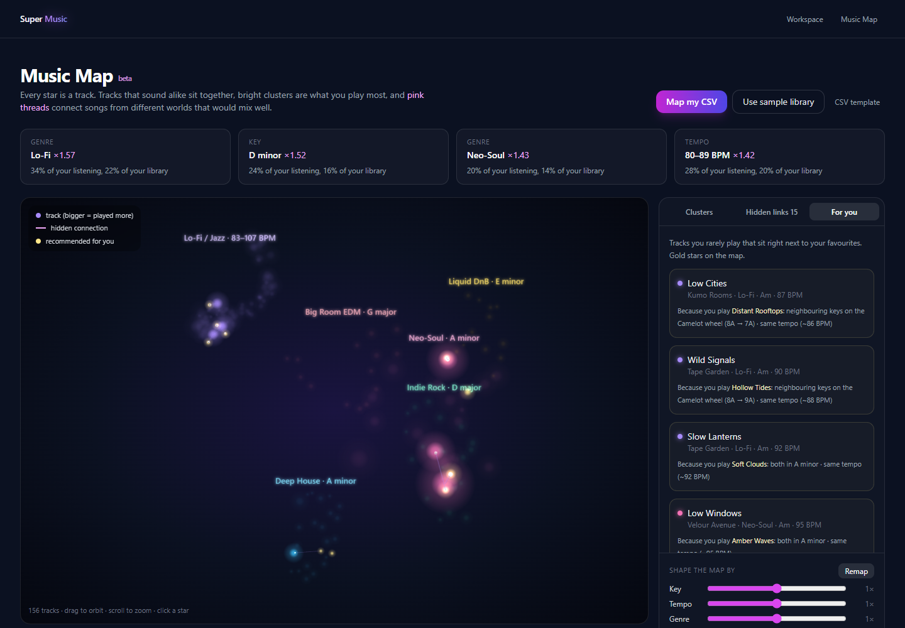

# Music Map

The Music Map turns a spreadsheet of songs into a 3D constellation of your taste. It's built to show you patterns you wouldn't spot in a playlist: which sounds you actually gravitate to, which songs from different genres secretly belong together, and what in your library you've been overlooking.



It is the home page: open **http://localhost:3000**. It loads a 156-track sample library (all made-up names) so you can explore right away.

## Reading the map

| You see | It means |
|---|---|
| ⭐ A star | One track. Hover for details, click to fly to it and see what it's connected to. |
| Bigger, brighter star | You play it more |
| A coloured cloud | A **cluster**: tracks that share a sound (genre, key, tempo, mood) |
| Faint lines | Each track's closest matches |
| **Pink threads** with moving sparks | **Hidden connections**: songs from *different* clusters that still match musically |
| 🟡 Gold stars (in "For you") | **Recommendations**: tracks you rarely play that sit right next to your favourites |

Position means similarity. Two stars close together sound alike on the things you've weighted. The exact axes don't mean anything on their own.

## The panels

**Clusters.** Every group is named after a real galaxy, with a plain-language description underneath, like *Andromeda: Neo-Soul · A minor · 84–95 BPM · upbeat*. The more songs in a cluster, the bigger its galaxy: the biggest cluster is IC 1101 (about 4 million light-years across, one of the largest galaxies known), mid-sized ones get names like Andromeda or the Milky Way, and the smallest get dwarf galaxies like Segue 1. Hover a name to see its galaxy's size. The bar shows its **signal**. With listening data, the signal is how much more you play the cluster than its size would predict: a cluster that is 14% of your library but 20% of your plays has a lift of 1.43×. Without listening data, it shows how tightly the tracks hang together. Click a cluster to light it up.

**Hidden links.** These are pairs of songs from different clusters that belong together anyway. They come from four kinds of evidence, taken in turn so no one kind crowds out the rest (each link is labelled with its kind):
- **Played together**: songs you keep playing back to back in the same listening session (at least twice, within 20 minutes of each other, skips left out). This comes from Spotify's streaming history files, and is often the most personal link: two songs that sound nothing alike but live together in your head.
- **Same playlists**: songs you put on the same playlists. A small playlist counts for more than a big one, a single shared playlist only counts when it is small (about 40 songs or fewer), and playlists over 200 songs (Liked Songs) are ignored. Playlists come from Playlist*.json in the account export, or one Exportify CSV per playlist (the file name is the playlist's name).
- **Musical match**: at least two musical traits in common: the **same or a neighbouring key** on the Camelot wheel (A minor sits next to E minor and D minor), the **same tempo or half/double time** (87 BPM neo-soul next to 174 BPM drum & bass), a **similar mood** (energy, valence, danceability), or a **similar sound** (among the closest 3% of pairs by CLAP sound description). Only songs that were looked up online, or came with key and BPM columns, can match this way.
- **Rare tag**: two songs that share a detailed genre tag almost nothing else in your library has ("nu jazz" on one jazz and one house song), from the same decade when possible.

- **Collaboration**: a song featuring (or credited with) an artist whose own songs sit in another cluster.

When those run short (a plain list of titles and artists has none of the first four), links that every library has fill the rest: **same artist** (an artist whose songs landed in two clusters), **same album** (a soundtrack or compilation split across clusters), and **next door** (the closest neighbours across a cluster border, one pair per two clusters). So the tab always has links once a map has two clusters.

They make good transitions, mashups and playlist bridges. The number of links grows with the library: 15 for a few thousand songs, up to 60. A library with no key or tempo still gets links from plays, playlists and tags, so import your streaming history and playlist files along with the library.

**For you.** This tab appears when your CSV has listening data. SuperMusic averages your most-played tracks into a "taste centre", then finds the least-played third of your library that sits closest to it. It favours clusters with high signal and never shows more than four picks from one cluster. Each pick says which favourite it resembles and why.

**Songs you may like.** Click any star (or any song in a list) and the side panel shows up to 8 songs from your library you may like if you like that one. When both songs have a sound description, how alike they sound counts for most of the score; otherwise it uses the map's own features, so the sliders still shape the picks. One artist can't fill the list (two songs each at most), songs you rarely play get a small nudge up, and each pick says why. The YouTube and Spotify buttons next to each song open it there: a direct link when your CSV has one (a Spotify `uri` like `spotify:track:…`, or a `youtube_url` column), otherwise a search for the artist and title. Recommending songs you don't own yet needs an outside music catalogue (see [What's next](#whats-next)).

**Search.** This tab appears when songs have a sound description. Type what you want to hear, such as *sad slow piano* or *aggressive distorted guitars*, and the 20 closest-sounding songs light up on the map.

**Your music, cluster by cluster** (below the map) is the atlas: one card per cluster with its share of your plays, key, tempo and years, its main artists, its most-played (or most typical) songs, and for clusters of 250+ songs the smaller groups inside it, named by what sets them apart ("D minor · 85–95 BPM"). Click a card to light that cluster up on the map. On big maps clusters are drawn as separate islands with a soft glow behind each, and clusters that would share a name are told apart by their main artist.

**Colour by** (top right of the map) recolours the same stars by one property at a time: genre, release year, when you first or last played a song, plays, skip rate, tempo, energy or mood. Only properties your files have are listed. Continuous ones run from dim blue (low) to bright (high), stretched over the middle 96% of your songs so one outlier can't wash the rest out; grey stars have no value. "First played" over a big history shows which parts of the map you found when.

**Your library in numbers** (below the map) describes the whole library: songs, artists, plays and hours; how concentrated your listening is ("half your plays come from 40 songs"); how varied it is (genre spread of the library vs of what you play); genres and top artists as share of songs vs share of plays (and skip rate on hover); keys on a Camelot grid; release decades and tempo; new songs per year coloured by cluster, so you can see your taste drift; and four lists: **Rediscover** (songs you played a lot but not in the last year of your history), **Keep skipping** (skipped at least half the times), **Odd ones out** (furthest from everything else) and **Never played** (in your library or playlists but not in your history). Click a song in a list to fly to it.

The **insight cards** across the top show the strongest skews in your listening, for example *"34% of your listening is Lo-Fi, though it's only 22% of your library."*

## Share your map

Press **Share** above the map to get a short link like `/?share=ASRLnVJ2`. Anyone who opens it sees the map as you saw it, can click around, **Remap** it with different sliders, see songs they may like and start a radio station. They can't change your copy.

- **Listed or link-only.** Tick *List it on Shared maps* to show it on the **Shared maps** page (`/maps`); unticked, only people with the link can find it.
- **People see it as you do.** A share includes everything the map was built from: play counts, likes, the *For you* picks, insight cards, *Your library in numbers*, sound search and your slider settings. To keep your listening private, untick *Include my listening data*; the share then drops play counts, likes, skips, play dates, the *For you* picks, the insight cards and *Your library in numbers*, and the song list copied into the share has those columns removed too. People see the songs, clusters and links.
- **The Shared maps page** shows each listed map as a card: a picture of the map (drawn on the server when it's shared, the galaxies glowing in their colours with hidden links in pink), how many songs, artists, galaxies and hidden links it has, its biggest galaxies, and a couple of highlights such as the galaxy its owner plays most, their most-played song, the strongest hidden link and the key, tempo and decade it leans towards. The most upvoted map is shown big at the top. Sort by **Most upvoted** or **Newest**.
- **Upvotes.** Anyone can upvote a map once, from its card or from the banner when they open it, and click again to take it back. Signed-in listeners vote as their account, others as their browser. One network can give a map at most 3 upvotes, so making new browser ids doesn't stuff the count. Votes are kept in `data/supermusic.db` (`map_votes`).
- **Stopping.** There are no accounts yet, so the browser that shared a map keeps a secret key for it. *Shared maps* lists the maps shared from this browser with a **Stop sharing** button. Clearing the browser's site data loses that key.
- **Where they're kept.** Each share is a folder in `data/shared_maps/` (the map, its settings, and a copy of the song list), so shares survive a restart. Only the sample, another share, or a CSV SuperMusic wrote itself can be copied into a share.

## Constellations

Join songs on your map with lines into a named shape, like a star sign: a mood, a memory,
a playlist. Open the **Constellations** tab, tap **New constellation** (or **Start a
constellation here** on a song's card), tap stars one after another, then **Done**, pick
a name and a colour and **Save**. Tap a saved one to fly to it; **Edit** and **Delete**
are under it. Up to 30 constellations of 2 to 40 stars each.

- Songs are kept by artist and title, so a constellation survives re-importing or Remap.
- Signed in, your own map's constellations are saved on your account (`GET/PUT
  /me/constellations`), so every device shows them. Signed out, and on the sample map,
  they stay in that browser.
- Sharing a map includes its constellations; visitors see them but can't change them.

**On the community atlas** anyone signed in can **Propose a constellation** across
everyone's music (3 a day). Listeners vote yes or no, one vote each (signed in or this
browser, at most 3 votes per network per proposal). With at least 5 votes and 80% yes it
becomes **official** and is drawn on the atlas for everyone. The status follows the votes,
so one that drops below 80% goes back to being a proposal. The proposer can take it down;
anyone can report it to the admins. Code: `backend/app/core/constellations.py`,
`frontend/components/map/ConstellationsPanel.js`, `frontend/lib/constellations.js`.

## Fix a song's stats (shared with everyone)

Online lookups get songs wrong sometimes: a tempo read at double speed (180 BPM for a 90 BPM song), the wrong key, an artist's genre stamped on every song. Click a star, then **✎ Fix stats or add a vibe** to correct its tempo (with ½ and ×2 buttons), key, genre, energy, happiness, danceability, how acoustic it is and its year, or to tag its **vibe** ("late night", "gym", "rainy day"). For each stat the panel shows what the lookup found and where from, what other listeners agreed on, and your own answer, with **Undo** to take yours back.

- **Your edit changes your map straight away** (the labels update at once; **Remap** moves the star).
- **It reaches everyone's map once a second listener agrees.** A correction becomes the shared value only when at least 2 different listeners agree and they make up at least 60% of the answers for that stat. "Agree" means close enough: within 4% for tempo (and 90 and 180 count as the same tempo felt half or double time), within 15 points out of 100 for energy-style scores, the same year, key or genres. The shared value is the average of the agreeing answers, so one wild answer can't drag it. Vibe tags show on everyone's map once 2 listeners use the same tag.
- **Guards against bad edits.** One answer per listener per stat; two browsers on the same network count once; each listener and each network address can make 500 edits a day; values must be sensible (tempo 40–250, a real key, genres from the list).
- **Who you are.** Without an account, your browser gets a random listener id (kept in its storage), so your edits follow you on that browser. Signed-in listeners vote as their account.
- **Where it's used.** Agreed values (and your own edits) replace the file's or the lookup's values every time a map is drawn: imports, **Remap**, shared maps when remapped, and *Songs you may like*. The saved library CSV is left as it was, so taking an edit back works.
- **Lookups are shared too.** Every online lookup's answer (Deezer tempo and year, the key and energy measured from the preview, the genre from listener tags) is saved in the same database with its source, and the fix panel shows it.

Everything lives in one SQLite file, `data/supermusic.db` (set `SM_DB_PATH` to move it), together with accounts. Code: `backend/app/core/community.py` (the agreement rules), `core/store.py` (the database), routes in `routes/community.py`.

## People

The **People** tab has two parts.

- **Listeners like you.** Your library compared with every map shared publicly (*List it on Shared maps*), closest first. Closeness is measured on artists, not exact songs, since two people who love an artist rarely saved the very same tracks: each library becomes "what share of my listening is each artist" (plays when the file has them, otherwise one per song), and the match is how much those two lists overlap (cosine similarity: 100% means the same artists in the same proportions). Each match shows the artists you both play, opens the other map, and lists up to five of their songs you don't have, songs by artists you already play first. Code: `backend/app/core/taste_match.py`.
- **Latest song fixes.** The newest edits from everyone, and how many listeners have fixed how many songs. Click a song to fly to it if it's on your map.

## The platform

The map is the home page (`/`; old `/map` links still work). Around it:

- **Accounts and profiles** (`/login`, `/u/<name>`): a display name, bio, your shared maps, followers, reputation and recent activity. Maps you shared before signing in move onto your account when you sign in.
- **Share card**: every shared map gets a 1200×630 picture (`/map/shared/<id>/card.png`) and its own page, `/s/<id>`, whose link previews show the card on social apps.
- **Compare**: `/?compare=<share id>` puts your map and theirs in one galaxy. Stars are coloured blue (only you), pink (only them) or gold (both), with a taste-match score and picks for each of you. Play counts are never shown.
- **Follow and feed** (`/feed`): what people you follow shared, plus upvotes, follows and agreed song fixes on your own maps. The **weekly digest** sits on top: songs to rediscover, new listeners close to you and what changed. It isn't emailed yet (that needs a mail server).
- **Community atlas** (`/atlas`): every publicly listed map merged into one universe; brighter stars are in more libraries. Light up your own songs and pin short notes to any song.
- **Artists** (`/artists`): upload a track to see which galaxy it lands in, its neighbours and the listeners whose maps are full of music like it. The audio is analysed and then deleted.
- **Reputation**: points for song fixes others agree with (10), being first to suggest a fix (5) and upvotes on your maps (2). Levels go Listener, Tuner, Curator, Cartographer, Astronomer.
- **Games and charts** (`/play`, Explore → Charts): a ten-question music quiz (release years, who recorded a song, which album, which came first), scored on the server, top maps of the week, top contributors and the most started radio stations.

## Map Radio

The **Radio** tab turns the map into a station. Songs that sound alike sit close together, so a station walks from star to star: each next song is one of the four closest unplayed ones (usually the closest), the same artist never plays twice in a row, and one artist gets at most one song in eight. **New mix** walks the same place again with different picks.

- **Around a song** spreads out from one song. Type a song or click a star; the song card also has **Start radio from this song**.
- **Through a cluster** wanders around one cluster, starting near a well-loved song in its middle.
- **From A to B** is a DJ-style path: it heads a little further towards the second song with every track, so the music changes gradually from one to the other.

It plays each song's **30-second preview** from Deezer, which needs no account or key (the backend looks the song up, because Deezer's API can't be called from a browser directly). Songs Deezer has no preview for are skipped. Every song in the station, and the one playing now, has **Spotify** and **YouTube** buttons that open the whole song there (the library's own link when it has one, otherwise a search); opening one pauses the preview. Full songs can't be played inside SuperMusic: Spotify only lets other sites play full tracks for Premium listeners through its own player, and Apple Music needs a paid developer account.

**Take it with you.** Under a station:

| Button | What it does | Needs |
|---|---|---|
| **Copy Spotify links** | Copies one `open.spotify.com` link per song. In the Spotify desktop app, open a playlist, click in its song list and press Ctrl+V (Cmd+V on a Mac). | Songs with Spotify links: Spotify exports and Exportify CSVs have them |
| **Save to Spotify** | Signs you in to Spotify and creates a private playlist; songs without a link are searched by title and artist. | Your own free Spotify app, below. Shown only when one is set up |
| **Play on YouTube** | Finds each song on YouTube and opens them as one playlist (`youtube.com/watch_videos?video_ids=…`, 50 songs at most). Press **Save** on YouTube to keep it. | `yt-dlp` on the server (it's in `requirements.txt`) |
| **Download CSV** | Title, artist, album and Spotify link per song. Converter sites such as TuneMyMusic or Soundiiz turn it into an Apple Music, Spotify or YouTube Music playlist. | Nothing |

YouTube's official API isn't used: it allows each app 10,000 points a day, a search costs 100 and adding a song to a playlist costs 50, which is about two 50-song playlists a day for everyone. yt-dlp's search has no quota, and found videos are cached in `data/cache/youtube_ids.json`.

### Setting up "Save to Spotify"

1. Sign in at [developer.spotify.com/dashboard](https://developer.spotify.com/dashboard) and create an app. Tick **Web API**.
2. Add the redirect URI `http://127.0.0.1:3000/spotify-callback`. Spotify no longer accepts `localhost`, so open SuperMusic at **http://127.0.0.1:3000** when you use this.
3. Put the app's Client ID in `.env` as `SPOTIFY_CLIENT_ID=...` and run `docker compose build frontend && docker compose up -d`. Without Docker, set `NEXT_PUBLIC_SPOTIFY_CLIENT_ID` before `npm run build` or `npm run dev`.
4. Make sure `CORS_ORIGINS` includes `http://127.0.0.1:3000` (the default does).

New Spotify apps start in **development mode** (rules as of February 2026): the app's owner needs Spotify Premium, and only the owner plus up to 5 people added under **User Management** in the dashboard can sign in. Opening it to everyone ("extended quota") is only for registered businesses with at least 250,000 monthly users. That makes it a good fit for you and a few friends, and the copy-links and CSV routes cover everyone else. Sign-in happens in the browser (PKCE), so no Spotify secret is stored anywhere.

## Shape the map

The sliders change what "similar" means, from 0× (ignore) to 2× (dominant). Click **Remap** to apply.

- **Key:** turn this up to find harmonic matches across genres
- **Tempo:** groups by BPM
- **Genre:** turn it down to let sound, not labels, decide
- **Mood:** energy, valence, danceability, acousticness…
- **Artist:** pulls an artist's tracks together
- **Sound:** how songs actually sound (instruments, production, vocals), heard by an AI model. Only shown when songs have a sound description

## Sound descriptions (CLAP)

When you import with **Look up … online** ticked and the `clap` service is running (`docker compose up -d clap`), each song's 30-second Deezer preview also goes through [CLAP](https://huggingface.co/laion/clap-htsat-unfused), an AI model trained on audio paired with text descriptions. It turns the preview into 512 numbers that describe how the song sounds, and that description powers the **Sound** slider, "similar sound" hidden links, closer **For you** picks and **Search**. The import shows this as a "Listen to previews" step. It is the slow part of a big import, so you can skip it: untick **Listen to previews** before importing, type a number in **Only listen to the … most-played songs**, or press **Skip** next to the step while it runs (songs heard so far keep their sound description and the map is drawn straight away). Songs already heard are cached, so later imports only listen to new ones.

- In a test on 560 songs, songs with similar CLAP descriptions shared a genre 39% of the time, against 16% for key, tempo and energy alone (see the research section below).
- Descriptions are saved in the library CSV as a `sound` column, so **Remap** and **Search** don't need to redo the work. They're also cached in `data/cache/sound_clap/`, so importing the same songs again is quick.
- A CSV with a `local_path` column pointing at audio files on the server uses those files instead of Deezer previews.
- CLAP runs on the CPU in about a second per song; `docker-compose.gpu.yml` puts it on the GPU. The model (a few hundred MB) downloads into `data/models/hf` the first time.
- Without the service, or without online lookups, the map works exactly as before.

## Import from Last.fm (no files)

If you scrobble to Last.fm, click **From Last.fm** on the map (or use the **Import from Last.fm** card in the Studio) and type your username. No password and no export are needed, because Last.fm makes listening data public. You are taken to the Studio, which shows what is happening while it runs: first your library is read from Last.fm, then each song is enriched (genre, year, tempo, key and energy, exactly as in the next section). It keeps running while you look around the rest of the site, and when it is done the Studio offers **Open it in the Music Map**.

What is read ([`core/lastfm_import.py`](../backend/app/core/lastfm_import.py)):

- **Top tracks** (all time, up to 2,000 by default): every song you've scrobbled and its play count.
- **Loved tracks**: become "liked".
- **Your latest 5,000 scrobbles**: last-played dates, albums, and which songs you play back to back (the "played together" hidden links). First-played dates are only kept when those pages cover your whole history.

The server needs a free `LASTFM_API_KEY` in `.env` ([get one here](https://www.last.fm/api/account/create)); without it the card says so. Requests share the Last.fm rate limit with the genre lookup. A profile with "Hide recent listening" turned on can't be read, and the error says how to change that. API: `POST /csv/import-lastfm` with `{"username": "...", "lookup": true, "limit": 500}` returns a job you poll at `GET /csv/jobs/{id}`; `GET /csv/lastfm/status` says whether the key is set.

## Import from Spotify or Apple Music

Click **Import your library** and pick one or more files. SuperMusic works out what each file is from its columns:

| Service | File | Where to get it |
|---|---|---|
| Spotify | Playlist CSV | [Exportify](https://exportify.net). Tick the audio features and artist data options for the best map |
| Spotify | `StreamingHistory_music_*.json` or `Streaming_History_Audio_*.json` | Spotify › Account › Privacy › Download your data (basic or extended history) |
| Apple Music | `Apple Music Play Activity.csv`, `… Track Play History.csv`, `Apple Music Library Tracks.json` | [privacy.apple.com](https://privacy.apple.com) › Request a copy of your data › Apple Media Services |
| Apple Music | Playlist export `.txt` | Music app › select a playlist › File › Library › Export Playlist… |

Spotify's account data download also has `YourLibrary.json` (your liked songs, marked as liked) and `Playlist1.json` (every song gets a `playlists` column naming the playlists it is in). Streaming histories also give each song a `first_played` and `last_played` date. A whole account download can be picked at once; podcast files are recognised and skipped.

Pick a library or playlist file **and** a listening-history file together. Songs are matched by artist and title (ignoring "feat." credits), plays and skips are added up, and features come from whichever file has them. A play shorter than 30 seconds counts as a skip.

Listening histories don't include genre, tempo or key. With **Look up genre, tempo, key and energy online** ticked (the default), each song is looked up online. **Genre** comes from listener tags: Last.fm if you put a free `LASTFM_API_KEY` in `.env`, otherwise MusicBrainz (no key needed). Tags are boiled down to about 20 plain genres (Pop, Hip-Hop, R&B, Rock, Electronic, Latin, …), non-genre tags such as "seen live" are dropped, and each song keeps at most two. Deezer's album genre is only a last resort, because Deezer files whole albums under one coarse genre and calls a lot of non-rap music "Rap/Hip Hop". **Release year** comes from Deezer, but only from a search hit by the same artist, so a similarly titled song by someone else can't be used. The song's 30-second preview is then analysed on your computer for tempo, key (Krumhansl–Schmuckler), energy and brightness. Only song titles and artists leave your machine. Results are cached in `data/cache/deezer_v2` and `data/cache/genres` (one lookup per artist), so re-importing is quick. While it runs, the import panel shows each step, how many songs were found, not found or failed, and the time left, worked out from how long lookups and map drawing actually take on your computer. If the first lookups all fail because the services can't be reached, the rest are skipped and the panel says so. Up to 500 songs are looked up by default, most-played first (change it in the import panel), and previews are listened to for the 50 most-played. Once the first lookup works, eight songs are looked up at a time; each service still gets no more requests than it allows (Deezer about 8 a second, Last.fm 4 a second, MusicBrainz 1 a second), songs on the same album share one album request, and songs by the same artist share one genre request. On a first import that is roughly 2–3 new songs a second. MusicBrainz's one-request-a-second limit is the slowest part when a library has many different artists, so setting a free `LASTFM_API_KEY` is the biggest extra speed-up for big libraries. Genres already in your file (for example Spotify's artist genres in an Exportify CSV) are always used as they are; the online lookup only fills in songs that have none.

The merged library is saved to `data/processed/library/`, and the sliders and **Remap** work on it like any other map.

The **CSV / library files** card on the Studio page does the same merge without drawing a map: drop in any number of files, get one deduplicated, enriched CSV back with a summary of what each file was, how many duplicates were merged and how many songs now have each detail, plus an **Open it in the Music Map** link. With several files you can also pick **One file per input**: each file comes back as its own enriched CSV (its own songs and play counts, with details looked up once and shared across files), plus a .zip of them all.

**Big libraries.** Maps up to 50,000 songs are allowed. On a 4-core CPU a 23,000-song library draws in about 25 seconds (plus about 20 seconds once per server start, while UMAP compiles its fast neighbour search; the server does that in the background at start-up). Above 2,500 songs the 3D view draws all stars as one point cloud and all links as one set of lines, so it stays smooth; the overview names the 12 biggest clusters, and big libraries get up to 24 clusters instead of 10.

## Your own CSV

Use the same **Import** button. Column names are matched loosely (case doesn't matter), and every column is optional, but the more you include, the better the map gets. **CSV template** downloads the sample to copy from.

| What | Column names it recognises |
|---|---|
| Name | `title`, `name`, `track`, `song` |
| Artist / album | `artist`, `artists` / `album` |
| Genre | `genre`, `genres`, `style`, `tags` (split several with `;` or `,`; `Hip-Hop/Rap` stays one genre) |
| Key | `key` as `Am`, `C#m`, `F# minor`, `Bb`, Camelot `8A`, or Spotify's `0–11` plus a `mode` column |
| Tempo | `bpm`, `tempo` |
| Mood | `energy`, `valence`, `danceability`, `acousticness`, `instrumentalness`, `speechiness`, `liveness`, `loudness` |
| Era | `year` |
| **Listening** | `play_count`, `plays`, `listens`, `streams`, `rating`, `liked`, `loved`, `skip_count` |

Exports from Spotify tools (Exportify and similar) work as they are, because they already use `key`, `mode`, `tempo`, `energy` and `valence`.

```csv
title,artist,genre,key,bpm,energy,valence,play_count,liked
Slow Letters,June Hollis,Neo-Soul,C,90,0.54,0.62,68,0
Faded Cities,Coastline Theory,Liquid DnB,Am,173,0.83,0.52,0,0
```

Limits: at least 3 tracks and at most 5,000. Under 12 tracks, the layout uses PCA instead of UMAP.

## How it works

1. **Features.** Each track becomes a vector. Keys are placed on the Camelot wheel as an angle, tempo goes on a log scale, genres and recurring artists become tags (each song's detailed genre tags, such as Spotify's "toronto rap, pop rap, canadian pop", are also summed up into one or two broad genres like Hip-Hop or Pop; the broad genres carry most of the weight and name the clusters, so one tag that many artists share can't label everything. When most of your library is one genre, say Hip-Hop, clusters are named after the subgenre that sets them apart instead, such as West Coast Hip-Hop, Trap or Trap Soul, and a cluster where no genre leads is called a "Mix of …"), and mood columns are standardised. Your slider weights scale each part.
2. **Layout.** UMAP squeezes the vectors into 3D, and each cluster is then opened up a little so every star is visible.
3. **Clusters.** k-means runs on the 3D layout, and the number of clusters is picked automatically by silhouette score.
4. **Links.** Each track links to its nearest neighbours. Hidden connections keep only pairs from different clusters, from four sources: back-to-back plays (the `played_with` column the import writes from streaming history), shared playlists weighted by 1 / log₂(playlist size + 1), a separate "musical only" space (key, tempo folded by octave, mood, and sound when there is one), and detailed tags held by at most 0.2% of the library.
5. **Taste.** Plays, ratings and likes combine into one score per track, with skips counting against it. Those scores drive cluster signal, insights and picks.

The code lives in [`backend/app/core/music_map.py`](../backend/app/core/music_map.py), and the 3D view in [`frontend/components/map/Graph3D.js`](../frontend/components/map/Graph3D.js). To regenerate the sample library, run `python scripts/make_sample_library.py`.

## Research: would a music model map better?

The map's features are hand-picked (key, tempo, genre, mood). A music model can instead listen to each song and produce one vector for it. This experiment checked whether that groups songs better. The idea is explained for beginners in [How it works](how-it-works.md#could-a-learned-embedding-do-better-the-mert-and-clap-experiment).

**Short answer: yes.** Same-genre neighbours: CLAP (`laion/clap-htsat-unfused`) 38.7%, MERT layer 7 34%, the map's features 16.3%, chance 7.1%. CLAP also gives text search ("sad slow piano ballad") for free.

`scripts/compare_embeddings.py` describes each song three ways and compares them:

- **map**: the Music Map's own features from audio (key on the Camelot wheel, tempo, energy, brightness)
- **MERT** (`m-a-p/MERT-v1-95M`): a self-supervised music model, averaged over time
- **CLAP** (`laion/clap-htsat-unfused` by default): an audio-and-text model, averaged over time

Averaging over time follows *Diffusable Latents from Structure-Agnostic Distillation* (2026): one vector per song keeps what the song sounds like and drops where in the song each sound happens.

### First run (2026-10-11, RTX 2060)

560 Deezer chart previews (30 s each) from 14 genres, labelled with the chart's genre. The scores use k = 10 nearest neighbours.

| Spaces | Shared neighbours | Linear CKA |
|---|---:|---:|
| map vs MERT | 8.8% | 0.36 |
| map vs CLAP | 5.4% | 0.27 |
| MERT vs CLAP | 13.3% | 0.29 |

Two random spaces would share 1.8% of neighbours.

| Space | Neighbours sharing the song's genre (other artists only) |
|---|---:|
| map | 16.3% |
| MERT (average of all layers) | 28.9% |
| MERT layer 7 (best) | 34% |
| CLAP | 15.5% (suspect, see below) |

Random would be 7.1%.

**What it says**

- The map's neighbours mostly disagree with what MERT hears. Only about 1 in 11 of a song's closest matches is the same in both. Key, tempo, loudness and brightness alone are a thin description of a song.
- MERT groups songs by genre about twice as well as the map does, without ever being told about genres. Its middle layers (5 to 8) do best. The last layers are worse, probably because they're tuned to MERT's training task rather than to overall sound.
- These Deezer genre labels are noisy. A chart's genre is a marketing label, and many songs fit several genres. The absolute numbers are therefore low for every space. Compare them with each other, not with 100%.

### CLAP re-run (2026-10-12): a different checkpoint works

The first run used `laion/larger_clap_music`. Its text search returned the same five songs for every phrase, and its genre score (15.5%) was no better than the map's. Re-running with `laion/clap-htsat-unfused` on the same 560 songs:

| Space | Neighbours sharing the song's genre (other artists only) |
|---|---:|
| map | 16.3% |
| MERT (all layers / layer 7) | 28.9% / 34% |
| **CLAP, clap-htsat-unfused** | **38.7%** |
| CLAP, larger_clap_music (first run) | 15.5% |

Health checks for clap-htsat-unfused: no missing weights. The average similarity between different songs is 0.73, which is high but far from collapsed (1.00). Zero-shot genre ("This is a *genre* song.") is right 26.1% of the time; chance is 7.1%.

Text search now works. "aggressive distorted guitars" returns TOOL, AC/DC, Megadeth and Metallica. "smooth jazz with saxophone" returns Euge Groove and Stanley Clarke. "sad slow piano ballad" returns Yiruma, Olivia Belli and a Schubert impromptu. It still has misses: "rap with a trap beat" returns Com Truise and Europe, and "acoustic guitar and soft singing" puts TOOL first.

Map vs CLAP neighbour overlap is 6.8% (CKA 0.38), so CLAP also disagrees with the map's current notion of "similar".

**What this means**

- CLAP (clap-htsat-unfused) groups songs by genre best of the three, and it also gives text search for free. It is now the script's default.
- MERT's layer 7 comes second. Combining the two may beat either, but that hasn't been tested.
- Why larger_clap_music failed is unknown. The re-run of that checkpoint with the new health checks (`--clap-model laion/larger_clap_music --name clap_music`) would show whether weights are missing or every song collapses to the same vector. Until then, don't use it.
- Done (2026-10-12): the map now has a CLAP "sound" feature, slider and search. See [Sound descriptions](#sound-descriptions-clap).

## What's next

See the [roadmap](roadmap.md#-music-map-next-steps). The big one is recommending songs that **aren't** in your library yet.
