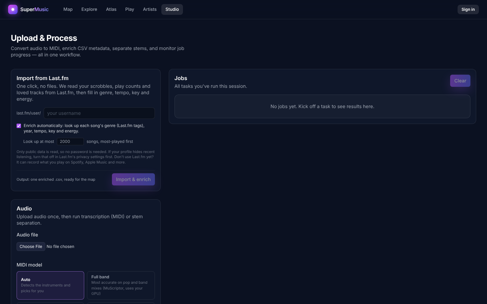

# 🛠️ Usage guide

## Start the app

```bash
docker compose up --build
```

Then open **http://localhost:3000/upload**.

## In the browser



### 🎹 Turn a song into MIDI

1. Under **Audio**, choose an `.mp3`, `.wav` or `.flac` file.
2. Pick a **MIDI model**: **General** for anything, or **Piano** for solo piano. Piano mode uses a model trained on the MAESTRO dataset and also captures note velocity and the sustain pedal. Its first run downloads about 170 MB of model files into `data/models`.
3. Click **Transcribe → MIDI**.
4. The job appears under **Jobs**. When it finishes, download the `.mid` file.

### 🥁 Split a song into stems

1. Choose an audio file under **Audio**.
2. Click **Separate Stems**.
3. You get four `.wav` files: vocals, drums, bass and other.

Demucs is heavy, so this can take a few minutes on a CPU.

### 🧾 Enrich a CSV of tracks

1. Under **CSV**, choose a `.csv` file.
2. Click **Enrich CSV** and download the enriched copy when it's done.

Each row needs either a `youtube_url` or a `local_path` that points to an audio file **the server can see** (for Docker, a path inside `./data`, written as `/app/data/...`). Rows without reachable audio are kept but not enriched. Columns like `title` and `artist` are used for MusicBrainz lookups.

```csv
title,artist,youtube_url,local_path
Me at the zoo,jawed,https://www.youtube.com/watch?v=jNQXAC9IVRw,
My demo,Me,,/app/data/raw/uploads/audio/demo.mp3
```

### 🌌 Explore the Music Map

Open **http://localhost:3000/map**. It starts with a sample library; click **Map my CSV** to use your own. The [Music Map guide](music-map.md) explains what you're looking at.

### 🌐 Try the 3D demo

The home page has an interactive 3D plot. Use **Upload CSV** there to plot your own data; the bundled sample (`frontend/public/data/sample_dataset.csv`) shows the expected `x`, `y`, `z` columns.

## From the command line

Every feature is also an API call. Uploading a file gives you a server path, and you pass that path to a job.

```bash
# 1. Upload
curl -F "file=@song.mp3" http://localhost:8000/upload/audio
# → {"success": true, "path": "/app/data/raw/uploads/audio/song.mp3", ...}

# 2. Start a job
curl -X POST http://localhost:8000/midi/convert \
     -H "Content-Type: application/json" \
     -d '{"source_path": "/app/data/raw/uploads/audio/song.mp3"}'
# → {"id": "c323309a-…", "status": "running", ...}

# 3. Check on it until status is "done"
curl http://localhost:8000/midi/jobs/c323309a-…
# → {"status": "done", "result": {"artifacts": {"midi": "/app/data/artifacts/c323309a-…_song.mid"}}}

# 4. Download the result (use the file name from the artifact path)
curl -O http://localhost:8000/artifacts/c323309a-…_song.mid
```

Download straight from a link:

```bash
curl -X POST http://localhost:8000/tracks/download \
     -H "Content-Type: application/json" \
     -d '{"url": "https://www.youtube.com/watch?v=jNQXAC9IVRw"}'
```

All endpoints are listed in the [API reference](api.md), and you can try them at **http://localhost:8000/docs**.

## Run the tests

```bash
docker compose exec backend python -m pytest -q backend/tests
```

## Common problems

| You see | Try |
|---|---|
| `failed to solve … npm run build` | Pull the latest `master`; this was fixed. |
| Backend keeps restarting | `docker compose logs backend` shows the error. |
| A job says `error` | Open `/{area}/jobs/{id}` and read `error_detail`. |
| Jobs disappear | Jobs live in memory and vanish when the backend restarts. Your files in `./data` stay. See the [roadmap](roadmap.md). |
| Download job fails on YouTube | YouTube changes often. Rebuild to get the newest yt-dlp: `docker compose build --no-cache backend`. |
